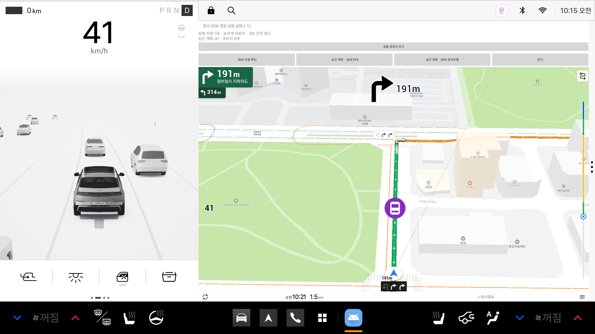
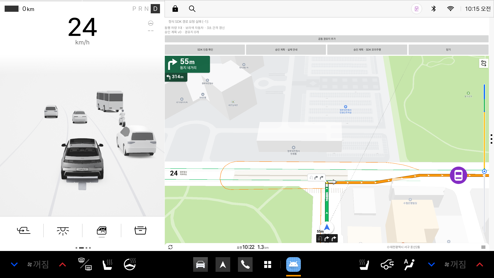

# 실제 길안내 주행 중 동행 차량 표시·녹화

> 후속 구현: [도로별 제한속도를 따르는 주행](ROAD_SPEED_LIMIT_DRIVING.md). 실제 SDK의 50→10km/h 제한을 구간별로 적용하고 낮은 제한 진입 전에 감속하도록 변경했다.

2026-11-12. **이미 켜진 정식 TMAP 길안내를 유지한 채 두 차량을 실제로 이동시켜, 내 차량 화살표·회전 안내·속도·보라색 동행 차량이 함께 갱신되는 것을 확인했다.** 이번 재생 과정에서 앱 재시작이나 명시적인 SDK 경로 재요청은 하지 않았다.

## 바로 볼 영상

- [1번 실제 길안내 주행 + 동행 차량 아이콘](videos/2026-11-12/sdk-route/A-active-driving.mp4)
- [2번 동행 지도 + 다른 가변 속도](videos/2026-11-12/sdk-route/B-active-driving.mp4)

영상은 각각 약 **75초**, 실제 이동 재생 구간은 약 60초다. 1번은 약 **324m**, 2번은 약 **429m**를 이동했다. 전체 경로 완주·도착 검증은 아니다. 실제 차량이 아니라 에뮬레이터의 테스트 GPS 주행이다.

영상의 약 15초 지점에서 계기판과 내비 속도 **41km/h**, 회전 안내 **191m**, 전방의 보라색 동행 자동차를 볼 수 있다. 약 45초 지점에서는 **24km/h·55m**로 바뀌고 동행 차량이 다음 도로로 이동해 있다. 정차 후 다시 출발하는 구간도 포함한다. 지도 배경만 움직이거나 마커만 임의로 옮긴 검사가 아니다.





## 왜 이전 검사는 충분하지 않았는가

최초 길안내 요청의 성공만 보고 주행을 완료한 것으로 설명한 것은 잘못이었다. 이어서 기존 `adb emu geo fix` 재생을 시도했을 때도 서버 좌표와 계기판은 변했지만 이 환경의 Android GNSS provider가 동일한 좌표·속도 0을 반복해 내비의 회전 거리가 고정됐다. `geo fix`와 NMEA 명령이 `OK`를 반환해도 Android에 같은 값이 남는 것을 `dumpsys location`에서 확인했다. 위성 수 보정만으로 해결되지 않았다.

따라서 초기 `2026-11-12-active-guidance` 루트와 `valid-gps` 기록은 실제 내비 주행 성공 근거로 사용하지 않는다. `android-gps`에서는 Android 테스트 GPS로 SDK 위치·속도 갱신은 확인했지만 REST 경로와 SDK 경로가 달라 이탈했고, `android-gps-visible`에서도 이탈이 포함됐다. **최종 유효 검증은 `sdk-route` 폴더의 영상·JSON·캡처다.**

## 이번에 확인한 수정과 증거

1. SDK 앱을 다시 설치하거나 길안내를 요청하지 않았다. 같은 프로세스 PID를 유지했다.
2. `server/TestGps.java`는 shell 전용 테스트 도구다. Android 테스트 GPS에 좌표·실제 속도·진행 방향·단조 증가 시간·정확도·위성 8개를 전달한다. SDK 내부 GPS 속도가 계기판과 함께 변하는 것을 확인했다.
3. 실행 중 SDK의 `observableRouteData`를 JDWP로 읽어 **SDK가 실제 선택한 42개 경로 좌표, 약 2,273m**를 로컬에 저장했다. 임의의 REST 경로를 SDK 경로라고 가정하지 않았다. 메서드 호출이나 메모리 값 조작 없이 필드를 읽었고 디버거는 분리했다.
4. 같은 SDK 경로 위에서 1번을 약 682m 진행 위치, 2번을 약 802m 위치에 배치해 시작했다. 카메라 안에서 볼 수 있도록 초기 간격을 약 120m로 설정한 시연이다. 가변 속도는 기존 모델을 사용하며, 2번에 정식 내비 SDK를 실행하지 않았다.
5. 회전 안내의 거리 값이 실제로 바뀌는 것을 자동 검사하고, 캡처와 영상에서 확인했다. 단순히 길안내 UI가 존재한다는 이유만으로 통과시키지 않았다.
6. 최종 MP4의 15·30·45초 프레임을 디코딩하고 각각 동행 아이콘이 보이는 것을 확인했다. 완료 후 두 계기판은 P·0km/h로 복귀했다.

앱 상단에는 이전 SDK 오류/이탈 콜백의 문구가 남아 있다. 이를 수동으로 지우거나 성공 상태로 바꾸지 않았다. 최종 검증은 실제 SDK의 회전 거리·내비 속도·경로 위 차량 표시 변화와 같은 PID 유지에 근거한다. 서버의 `source=demo`는 테스트 위치임을 표시한다.

- [주행 표본·거리·SDK 진단 원문](test-results/2026-11-12-active-guidance/sdk-route/result.json)
- [최종 영상 길이·아이콘 디코딩 검사](test-results/2026-11-12-active-guidance/sdk-route/video-validation.json)

## 테스트 상태와 재현

SDK 경로 덤프는 `build/active-sdk-route.json`에, 영상 원본은 Git에서 제외된 `build/`에 저장했고 공유본은 `docs/videos/2026-11-12/`에 Git LFS로 보관한다. `server/DumpSdkRoute.java`는 이 SDK 버전의 난독화된 필드 매핑을 확인한 후 사용한 진단용 읽기 도구다. SDK 버전이 달라지면 그대로 쓰면 안 된다.

`server/record_active_guidance.py`는 기존 서버·모임·길안내 화면·경로 덤프·컴파일해 기기에 올린 GPS 헬퍼가 준비된 상태에서 실행한다. 새 경로를 요청하는 실행 스크립트가 아니다.

현재 테스트 GPS는 마지막 위치·속도 0으로 유지한다. Extended Controls의 일반 GNSS 입력으로 돌아가려면 다음 명령으로 이번 테스트 제공자와 shell mock 권한을 복원한다. 원래 GNSS가 고정되는 현상 자체는 별도 원인 조사 대상이다.

```powershell
python server/record_active_guidance.py --restore-gps
```

앱을 재빌드·재설치하지 않고 테스트를 마쳤으므로 현재 정식 길안내 화면도 유지했다.
