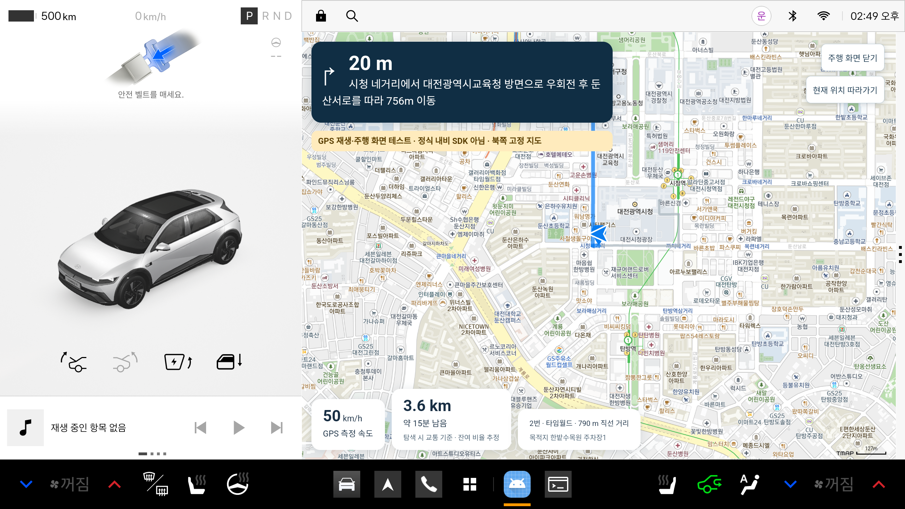
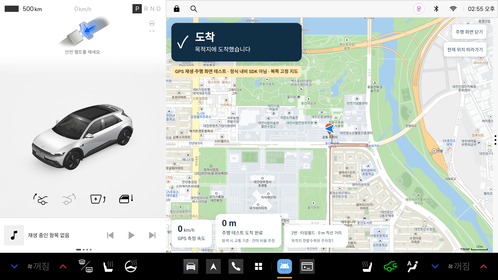

# 대전 시내 GPS 재생과 주행 화면

> **후속 작업:** [정식 TMAP 내비 SDK 연결 결과](NATIVE_TMAP_SDK.md). 아래 문서는 REST 기반 자체 주행 화면의 테스트 기록이다. 정식 SDK는 별도 화면에 연결했으며, 초기화·길안내 UI 표시를 확인했지만 후속 경로 요청 429로 내부 모의주행은 미검증이다.

2026-11-10. 플레오스 기본 내비의 현위치 고정 문제는 여전히 해결되지 않았다. 이번 화면은 **TMAP REST 도로 경로와 회전 정보를 사용하는 앱 자체 테스트 화면**이며, TMAP 정식 내비게이션 SDK를 설치한 결과가 아니다.

## 경로와 조작

- 1번: 대전시청 → 정부청사역 부근 테스트 경유점 → 한밭수목원 주차장1. 약 4.2km.
- 2번: 타임월드 → 같은 경유점 → 같은 목적지. 약 3.2km. 교통 상황에 따른 탐색 경로 변경으로 길이는 달라질 수 있다.
- 경유점은 도로 주행 재생용 좌표이며 실제 정차 장소를 추천한 것이 아니다.

모임에 참가하고 위치를 공유한 뒤 **경로·ETA 갱신 → 테스트 주행 화면**을 누른다. **주행 화면 닫기**를 누르면 기존 동행 화면으로 돌아온다.

주행 화면은 북쪽 고정 지도에서 현재 위치를 따라가며 다음 회전까지 거리와 TMAP 안내 문구, 남은 거리, 잔여 시간 추정, GPS 측정 속도, 일행까지의 직선 거리를 표시한다. 지나온 경로는 회색, 남은 경로는 파란색이다. GPS가 15초 넘게 갱신되지 않거나 경로에서 70m 넘게 벗어나면 경고한다. 자동 재탐색은 하지 않는다.

남은 시간은 처음 탐색한 TMAP 교통 소요 시간에 잔여 도로 길이 비율을 적용한 추정치다. 회전별 주행 시간을 다시 계산하거나 신호 대기를 판단하지 않는다. 위치는 가까운 도로 구간에 투영하는 시제품 로직이며 교차로나 겹친 도로에서 정식 내비 수준의 맵매칭을 보장하지 않는다. 음성 안내, 차선 안내, 지도 회전·3D, 백그라운드 주행은 포함하지 않는다.

## 재실행

로컬 서버와 두 에뮬레이터, 설치된 debug 앱이 필요하다. 아래 첫 명령은 두 앱의 시연 모임과 GPS 출발 위치를 새로 설정한다. 마지막 명령을 실행하면 두 화면에서 이동이 재생된다.

```powershell
python server/convoy_server.py
# 별도 터미널
python server/demo_city_drive.py
python server/demo_city_drive.py --replay
```

재생은 TMAP 도로 좌표를 약 2초 간격으로 `adb emu geo fix`에 주입하고, 앱이 Pleos FusedLocation SDK로 수신한 위치를 서버에 공유하는 경로를 통과한다. 지도 내부의 마커만 임의로 움직이지 않는다. 명목 속도는 36km/h이고 신호 정지는 생략한다. SDK 타임스탬프와 수신 간격에 따라 화면의 순간 GPS 속도는 흔들릴 수 있다.

먼저 합류점에 도착한 차량은 그 지점에서 기다린다. 양쪽이 도착한 뒤 10초 후 공통 목적지를 향해 다시 출발한다. 전체 재생은 약 7분이다. 에뮬레이터의 차량 속도/CAN 신호는 주입하지 않으므로 **왼쪽 차량 계기판의 0km/h와 앱의 GPS 속도는 별개**다. 실제 차량으로 주행한 기록이 아니다.

## 검증 및 자료

- `node server/test_driving.cjs`: 경로 진행, 다음 회전, GPS 속도, 경로 이탈, 오래된 GPS, 도착, 지나온/남은 경로 분리, 도로 구간 사이 가짜 연결 방지를 검사한다.
- `python -m unittest discover -s server -p 'test_*.py'`: 기존 서버 테스트 30개 통과.
- 두 에뮬레이터의 실제 WebView에서 지도·주행 안내와 새 SDK 좌표 수신을 확인했다. 최초 주행에서 남은 거리와 회전 안내가 바뀌는 것을 확인했다.
- 확대 지도에서 매 갱신마다 같은 줌/resize를 반복하던 처리를 줄이고 줌 16으로 조정하여 배경 지도 타일 표시를 확인했다.

이번 실기 재생은 **양쪽 모두 도착 확인으로 통과**했다. 명목 재생 경로 시간은 약 432.5초였고, 약 30초 간격의 SDK 위치 표본 15개를 저장했다. 합류점 대기 이후 공동 구간으로 이동했으며, 두 WebView의 도착 문구와 남은 거리 0m를 최종 확인했다. 시연 모임 코드는 `4124E703`이다. 두 화면은 도착 상태로 남겨 두었다.






최종 결과는 [replay-result.json](test-results/2026-11-10-city-driving/replay-result.json)에 저장했다. 원본 자료 디렉터리는 [2026-11-10-city-driving](test-results/2026-11-10-city-driving/)이다. 참가 인증 토큰과 전체 재생 설정은 Git에서 제외되는 `build/city-drive-session.json`에만 저장한다.
