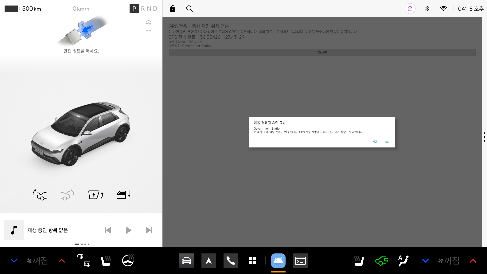
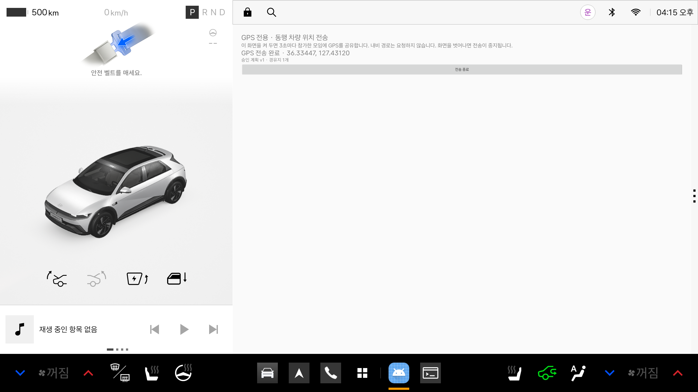
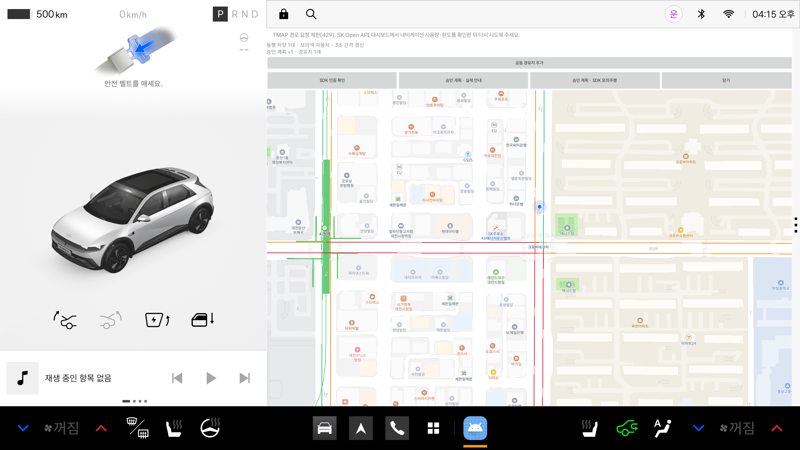

# 두 차량 주행 중 공동 경유지 제안·승인 테스트

2026-11-11. 서로 다른 출발지의 두 차량을 도로 경로에 따라 움직이고, 1번 화면에서 경유지를 제안해 2번 화면에서 승인하는 시나리오를 구현·검증했다.

**확인한 범위:** 두 차량 GPS 주행 재생, 실제 앱 화면의 제안·승인, 승인 전 기존 계획 유지, 승인 후 두 REST 경로 재계산과 변경 경로를 따른 GPS 재생까지 통과했다. **정식 TMAP 내비 길안내 경로 변경은 429로 거절돼 성공을 확인하지 못했다.** 계획 승인·REST 경로 변경·SDK 길안내 성공을 구분해야 한다.

## 시나리오와 결과

| 항목 | 설정 또는 결과 |
| --- | --- |
| 1번 출발 | 대전시청, 36.35063 / 127.38599 |
| 2번 출발 | 대전역, 36.33223 / 127.43417 |
| 출발점 직선 거리 | 약 4.776km |
| 공통 목적지 | 한밭수목원 주차장1 |
| 최초 도로 경로 길이 | 1번 2,587m / 2번 5,802m |
| 추가 공동 경유지 | 정부청사역 부근 테스트 좌표, 36.35768412 / 127.38104596 |
| GPS 재생 속도 | 명목 43.2km/h, 2초 간격 도로 좌표 주입 |
| 제안 전·승인 후 이동 | 두 차량 모두 각 구간에서 60m 이상 이동 확인 |
| 승인 전 | 계획 v0·경유지 0개 유지, 1번 찬성·2번 응답 대기 |
| 2번 승인 후 | 계획 v1·경유지 1개로 변경 |
| 변경 도로 경로 | 두 차량 모두 새 경유지 부근을 통과하는 경로로 재계산 |
| 경로와 경유 좌표의 최소 거리 | 두 차량 모두 약 8.42m |
| 변경 시점의 남은 경로 길이 | 1번 3,849m / 2번 8,002m |
| 정식 SDK | 초기 요청 및 v1 변경 요청 모두 오류 코드 429 |
| 2번 SDK 사용 | 초기화·길안내 요청 없음, GPS 전용 유지 |

초기 경로와 변경 후 경로는 계산한 출발 시점이 다르므로 위 두 길이의 단순 차이를 우회 거리로 해석하면 안 된다. 자동 검사는 승인 전후 비교 구간에서 GPS를 잠시 같은 위치로 유지해 구간 정보를 비교했고, 승인 전에는 계획 v0를 유지하고 승인 후에는 두 도로 경로의 구간이 변경됐는지 확인했다.

좌표는 지도 마커에 직접 대입한 값이 아니다. 실제 TMAP REST 응답의 도로 LineString을 따라 `adb emu geo fix`로 두 에뮬레이터의 GPS를 움직이고, 앱의 Pleos FusedLocation이 수신·전송한 값(`source=sdk`)을 서버에서 검증했다. 승인 후에는 그 시점의 각 차량 위치로 새 경로를 계산해 재생 경로를 교체했다. 2번은 내비 앱에서 길안내를 받은 것이 아니라 테스트 도구가 계산한 도로 경로에 따라 GPS를 재생한 것이다.

## 화면에서 확인한 제안·승인

1. 1번은 정식 내비 SDK 화면, 2번은 GPS 전용 화면을 사용한다.
2. 주행 재생 도중 1번의 **공동 경유지 추가**에서 이름·위도·경도를 입력하고 **제안 보내기**를 누른다.
3. 2번에 **공동 경유지 승인 요청** 창이 표시된다. 이 동안 기존 계획 v0를 유지한다.
4. 2번의 **승인**을 누르면 서버 승인 계획이 v1로 바뀌고 양쪽 화면의 경유지 수가 1개가 된다.
5. 1번은 내비 요청을 시작했던 화면에서 새 승인 버전을 감지해 새 경로를 한 번 요청한다. 같은 실패 버전을 주기적으로 재요청하지 않는다.







## SDK 반영 결과와 남은 범위

1번 진단 결과는 `sdk_requested_plan_version=1`, `waypoint_count=1`, `phase=ROUTE_FAILED`, `error_code=429`다. `sdk_plan_version`은 설정되지 않았다. 즉, 새 승인 계획을 SDK에 전달하는 연결은 실행됐지만 공급자가 길안내 요청을 거절했다. **정식 SDK의 새 경로 표시·회전 안내 변경·최종 도착까지 성공했다고 볼 수 없다.** 추가 재시도나 다른 키를 통한 한도 우회는 하지 않았다.

이번 검사에서는 초기 길안내 요청과 승인된 새 계획 요청을 각각 시도했다. 첫 자동 검사에서는 차량용 IME가 전체 화면으로 열려 좌표가 이름 필드에 연속 입력되는 문제가 발견됐다. 전체 화면 추출 모드를 막고 숫자 좌표 입력을 지정한 후 다시 빌드해 최종 화면 제안·승인 검사를 통과했다. 중단된 첫 검사에서도 초기 SDK 요청이 한 차례 거절됐으므로 이 작업 전체의 초기 시도를 한 건이라고 집계하면 안 된다.

앱 상단의 길안내 상태가 요청 중으로 남던 문제도 시작 정보 콜백에서 갱신하도록 수정했다. 다만 이번 실행은 SDK가 거절했으므로 수정된 성공 콜백을 실제 길안내에서 다시 검증하지 못했다.

한 번의 경유지 추가와 부분 주행을 검증한 결과다. 전체 경로 완주, 신호·CAN 속도 재생, 거절 후 연속 재제안, 여러 경유지 연속 추가와 기존 서버의 차량별 `applications` 영수증까지 통합한 완주 흐름은 이번 검증 범위에 포함하지 않았다. GPS 전용 화면은 켜 둔 동안만 위치를 전송한다.

## 실행과 검증 자료

새 로컬 서버는 8767 포트이며, 기존 8765·8766 서버를 변경하지 않는다. 테스트는 새 모임을 생성하고 두 에뮬레이터 앱을 다시 설치·실행한다.

```powershell
# SDK 경로 요청 없이 UI 승인·REST 경로·GPS 재생 검사
python server/demo_moving_approval.py

# 1번 초기 SDK 요청과 승인 후 새 버전 요청도 확인 (공급자 사용 한도 영향)
python server/demo_moving_approval.py --native
```

검사 후 서버와 화면은 유지하되 GPS는 마지막 테스트 좌표에서 갱신하도록 고정했다. 명령을 종료하면 해당 시연 서버도 종료된다. 토큰은 Git에서 제외된 `build/moving-approval-session.json`에만 보관한다.

- [실제 GPS 표본·계획 버전·SDK 결과](test-results/2026-11-11-moving-approval/result.json)
- [1번 승인 후 이동 화면](test-results/2026-11-11-moving-approval/A-moving-after.png)
- [2번 승인 후 이동 화면](test-results/2026-11-11-moving-approval/B-moving-after.png)
- 빌드: `assembleDebug`, `assembleDebugAndroidTest` 통과. 기존 JVM 테스트 5개 통과.
- 구현: `ConvoyPlanControls.kt`를 내비·GPS 전용 화면에서 함께 사용하고, `NativeTmapActivity.kt`에서 새 승인 계획 감지와 SDK 재요청을 연결했다.
