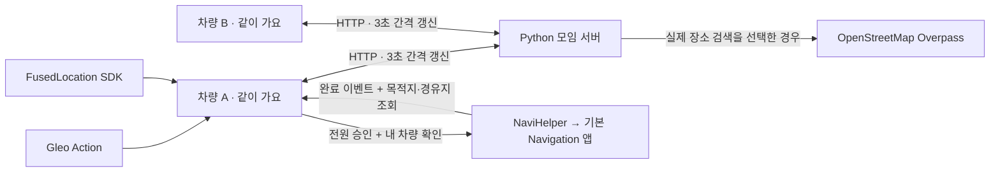
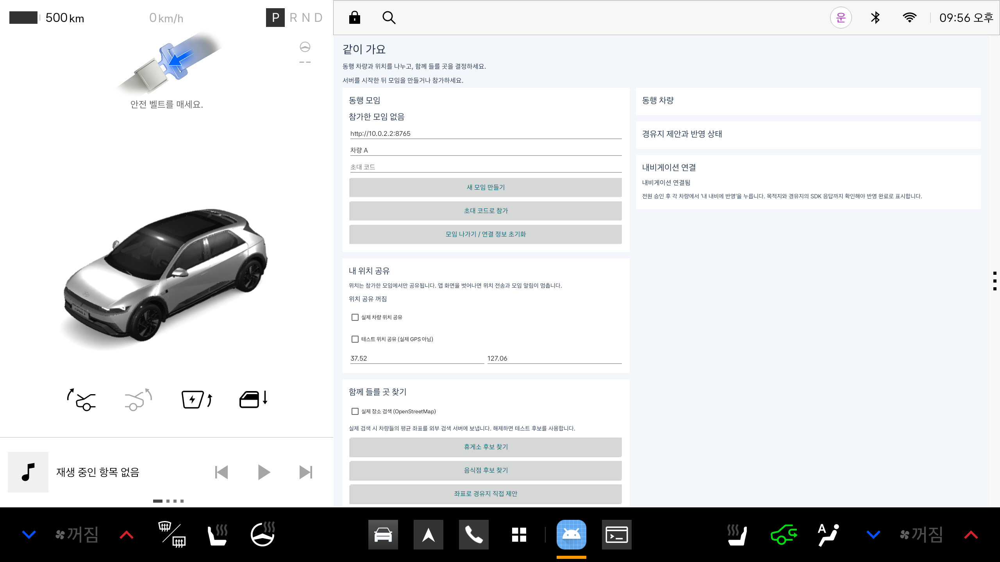

# Pleos 동행 주행 앱 구현 보고서

> **주행 중 경유지 승인 테스트:** [대전시청·대전역 출발 → 이동 중 제안·승인](DRIVING_APPROVAL_DEMO.md). 실제 앱 화면에서 1번 제안·2번 승인을 수행했고 두 차량의 변경 REST 경로를 따라 GPS 이동을 검증했다. 정식 SDK의 새 경로 요청은 429로 거절돼 길안내 변경 성공은 미확인이다.

> **2026-11-11 · 한 대 내비 + 동행 GPS:** [구현·검증 보고서](SINGLE_NAVIGATION_CONVOY.md). A만 정식 TMAP 길안내를 열고 B는 GPS만 전송한다. A의 내비 지도에 보라색 동행 자동차 마커를 추가했고, 실제 SDK 좌표 세 지점 이동·30초 만료·재접속 복원을 두 에뮬레이터에서 확인했다.

> **정식 내비 SDK 연결:** [TMAP Native SDK 구현·검증](NATIVE_TMAP_SDK.md). 두 에뮬레이터에서 ClientID 없이 SDK 초기화가 성공했고 공식 길안내 UI를 표시했다. 이후 경로 요청이 429로 제한돼 SDK 내부 모의주행의 이동·도착은 아직 미검증이다. GPU 사용 확인도 함께 기록했다.

> **시내 주행 시연:** [대전 시내 GPS 재생과 주행 화면](CITY_DRIVING_DEMO.md). 앱 자체 주행 화면에서 현재 위치 추적, 다음 회전, 남은 거리와 GPS 속도를 표시하고 두 에뮬레이터의 도로 좌표 재생을 추가했다. 정식 내비 SDK 또는 기본 내비 수정은 아니다.

> **경유지 직선 표시 수정:** TMAP의 경유지 보조 선을 도로 경로에 잘못 합친 오류를 수정했다. 두 에뮬레이터에서 재확인했고 서버 테스트 30개가 통과했다. [원인과 수정 화면](TMAP_IMPLEMENTATION.md#경유지-이후-직선-표시-오류-수정).

> **실시간 시연:** [건양대병원·고려대 세종 → 울산](ULSAN_DEMO.md). 건천휴게소 부산방향을 공동 경유지로 선정해 두 에뮬레이터에서 승인·반영을 완료했다. 시연 중 발견한 WebView 확인창 누락도 수정하고 회귀 테스트를 통과했다.

> **2026-11-10 최신 구현:** [TMAP 동행 기능 구현 및 검증](TMAP_IMPLEMENTATION.md). 기본 내비 대신 앱 안에서 실제 TMAP 경로·ETA·합류 후보를 표시한다. 선두 계획 승인, 동승자 웹 참가, 수동 EV 정보와 충전 후보를 추가했고 유가 정보는 제외했다. 아래의 NaviHelper/OSM 설명과 과거 테스트 기록은 이전 단계의 기록이다. 현재 경로 반영은 TMAP 앱 경로 준비를 의미한다.

> 최신 조사: [기본 내비 현위치 고정 수정 조사](#12-기본-내비-현위치-고정-수정-조사). **현위치 문제는 아직 미해결**이다. 내비 내부의 GSA fix 필수 조건과 차량 모드 기본 좌표 치환을 확인했다. 앞선 NMEA 체크섬 단독 원인 해석을 정정한다. FusedLocation SDK의 GPS 수신과 기본 내비의 현위치 갱신은 별개다.

작성일: 2026-11-04

## 1. 만들고자 한 것

여러 차량이 같은 목적지로 이동할 때 전화로 위치를 묻는 대신, 하나의 모임에서 위치를 공유하고 함께 들를 장소를 결정하는 앱이다. 출발지가 같아도, 달라도 같은 모임에 참가한다. 공동 경유지를 승인하면 각 차량의 현재 위치에서 출발하는 경로를 내비게이션에 요청한다.

이번 시제품은 **모임 생성 → 다른 차량 참가 → 위치 공유 → 후보 검색 또는 직접 지정 → 제안 → 전원 승인 → 각 차량에서 경로 변경 요청 → 차량별 실제 결과 확인** 흐름을 구현했다.

## 2. 구성



Android는 Kotlin과 기본 View를 사용했다. 서버는 Python의 `http.server`, `threading`, `urllib` 등 표준 라이브러리만 사용해 별도 패키지 설치가 필요 없다. 지도 화면이나 기본 Navigation APK는 수정하지 않았다.

설치 후 에뮬레이터에서 확인한 첫 화면:



## 3. 구현 과정

### 3.1 기존 프로젝트 확인

기존 `automotive`에는 도어 위치를 조회하는 예제가 있었다. 이를 동행 주행 화면으로 교체했다. 다른 모듈과 설치 패키지가 충돌하지 않도록 차량 앱의 applicationId를 `com.example.pleosprojectv01.convoy`로 구분했다. `mobile`, `shared`의 코드는 그대로 두었다.

이 앱에 필요한 FusedLocation 1.1.3과 NaviHelper 3.0.5만 직접 의존하도록 정리했다. 기존 음악 서비스 템플릿을 포함하는 `shared` 의존성과 미사용 LLM/Vehicle 의존성은 차량 앱에서 제거했다. 지도나 음성 기능이 SDK 이름을 추가하는 것만으로 구현되는 것으로 오해하지 않도록 실제 호출 부분을 분리했다.

### 3.2 모임 서버

`server/convoy_server.py`에 다음 처리를 추가했다.

- 8자리 초대 코드로 모임 생성·참가. 모임당 최대 8대.
- 참가 시 차량별 인증 토큰 발급. 이후 조회·변경 요청에는 해당 토큰이 필요하다.
- 위치 데이터는 위도·경도·측정 시각·실제/테스트 출처를 보관한다. 30초보다 오래된 위치는 검색에 사용하지 않는다.
- 제안 시 참여 차량 목록을 고정한다. 처리 중 새 차량 참가를 막고, 대기 중 차량이 나가면 해당 제안을 취소한다.
- 제안자는 제안 버튼으로 동의한 것으로 처리하고, 나머지 차량의 명시적인 응답을 기다린다. 한 대라도 거절하면 경로 반영을 허용하지 않는다.
- 제안 ID로 오래된 승인 요청을 거부한다. 경로 요청에는 별도의 시도 ID를 발급해 이전 결과가 새로운 시도를 덮어쓰지 못하게 한다.
- 전체 승인과 실제 반영 결과를 구분한다. 한 차량이 실패했다고 다른 차량까지 성공으로 표시하지 않는다.
- 서버 응답의 revision을 비교해 늦게 도착한 이전 화면 정보가 새 상태를 덮어쓰지 않게 했다.

데이터는 메모리에 보관한다. 서버를 재시작하거나 모임 생성 후 6시간이 지나면 새 모임이 필요하다. 모임 토큰은 모임 조회 결과에 포함하지 않고, Android의 앱 전용 저장 공간에만 보관한다. 앱 백업은 비활성화했다.

### 3.3 위치 공유

`PleosBridge.kt`의 `PleosLocation`이 SDK의 위치 리스너를 등록한다. 사용자가 **실제 차량 위치 공유**를 켜고 권한을 허용해야 사용한다. 측정 시각은 SDK의 원래 시각을 유지하며, 오래된 위치에 현재 시각을 붙여 최신 위치처럼 전송하지 않는다.

Debug APK에는 **테스트 위치 공유** 옵션도 있다. 차량별 위도·경도를 직접 입력해 동일 출발지와 다른 출발지를 모두 재현할 수 있다. 화면과 서버 데이터에 테스트 출처를 표시한다. Release APK에서는 이 테스트 위치 UI를 숨긴다.

앱 화면을 벗어나면 위치 수신과 서버 갱신을 중지한다. 현재 버전의 제안 알림도 앱이 보이는 동안에만 동작한다.

### 3.4 공동 장소 후보

두 가지 검색 방식을 제공한다.

| 방식 | 동작 | 용도 |
|---|---|---|
| 테스트 후보 | 차량들의 평균 위치 주변에 명확히 표시된 가상 좌표 3개 생성 | 외부 서버 없이 제안·승인 흐름 확인 |
| 실제 장소 | 평균 위치에서 반경 15km 안의 OSM `highway=services` 또는 `amenity=restaurant` 조회 | 공개 장소 데이터 연결 |

실제 검색은 사용자가 체크한 경우에만 실행한다. 이때 평균 좌표가 외부 Overpass 서버에 전달된다는 사실을 UI에 표시한다. 서버 전체에서 1분에 한 번만 실제 검색할 수 있게 제한했고, 응답 크기·시간에도 제한을 뒀다. 출처와 OpenStreetMap 저작자 표시를 제공한다.

후보는 **차량별 직선거리 중 가장 긴 거리**가 짧은 순서로 정렬한다. 한 차량에서만 가까운 장소보다 전체 차량이 접근하기 쉬워 보이는 후보를 앞에 놓기 위한 첫 구현이다. 도로의 진입 방향, 경로 중복, 교통 상황, 영업 여부, 실제 우회 시간은 계산하지 않는다. UI도 이를 도착 예상 시간이나 최적 경로 추천으로 표시하지 않는다.

OSM ID를 Pleos의 POI ID로 바꿔 넣지 않는다. 서로 다른 식별 체계이므로 좌표와 이름을 사용하고 Pleos POI ID는 빈 값으로 전달한다. 좌표 기반 경로 요청의 실제 수용 여부는 Navigation 앱의 결과로 판단한다. 원하는 후보가 없으면 **좌표로 경유지 직접 제안**을 사용한다.

### 3.5 제안 알림과 운전자 확인

새 제안을 받으면 앱 안에서 짧은 알림음과 승인/거절 창을 표시한다. 전원 승인 후에도 각 차량의 **내 내비에 반영** 버튼을 눌러야 해당 차량의 경로를 변경한다. 변경 전 목적지·경유지와 기존 경유지가 교체된다는 내용을 확인할 수 있다.

기존 내비게이션의 경유지를 자동 병합하는 기능은 이번 버전에 포함하지 않았다. 모임에서 정한 목적지와 새 경유지 1개로 경로를 요청한다.

### 3.6 NaviHelper 연결

`PleosNavigation`이 `requestRouteWithWaypoints()`를 호출한다. 필요한 `NAVI_ROUTE_SEARCH`, `NAVI_ROUTE` 권한을 Manifest에 선언했다.

| 표시 상태 | 의미 |
|---|---|
| 반영 요청 전 | 전원 승인이 났지만 이 차량은 아직 요청하지 않음 |
| SDK 확인 중 | 요청을 전송하고 실제 SDK 응답을 기다림 |
| 반영 확인 완료 | 경로 완료 이벤트 후 목적지와 경유지 좌표가 모두 요청과 맞는지 확인 |
| 반영 실패 | SDK 요청 예외 또는 내비게이션 오류 수신 |
| 반영 확인 불가 | 45초 동안 확인 응답이 없거나 앱 종료로 확인 중단 |

좌표 비교에는 위·경도 각각 0.001도 미만의 허용 범위를 사용했다. 실제 도로 진입점 보정 때문에 정확히 같은 좌표가 아닐 수 있기 때문이다. 서버도 요청이 90초 이상 미확인인 경우 `unconfirmed`로 바꾸며 성공으로 추정하지 않는다. 결과 전송이 끊기면 화면에 전송 실패를 표시한다.

SDK 이벤트에는 이 앱의 제안 ID가 포함되지 않는다. 따라서 한 차량에서 동시에 하나의 내비 요청만 추적하고, 완료 후 실제 목적지·경유지 조회로 확인한다. 다른 앱이 동시에 경로를 바꾸는 상황까지 완전히 구분하는 것은 추가 검증이 필요하다.

### 3.7 Gleo 연결

공식 형식에 맞춰 `assets/schema.json`과 Activity의 intent-filter를 추가했다. 함수는 최대 3개로 구성했다.

| Action | 동작 |
|---|---|
| `SHOW_CONVOY_STATUS` | 현재 모임 화면을 갱신하고 차량 수를 응답 |
| `FIND_MEETING_PLACES` | `rest_stop` 또는 `restaurant` 후보를 현재 선택된 검색 방식으로 조회 |
| `REVIEW_CONVOY_PROPOSAL` | 현재 제안의 확인 창을 열고 운전자 입력을 기다림 |

`ACTION_PARAM`의 JSON과 개별 Intent extra 형식을 처리한다. `APP_ACTION_RESPONSE` 콜백은 공식 `success`/`asking`/`fail` 형식을 따른다. 공개 브로드캐스트에는 인증 토큰, 초대 코드, 차량 이름, 정밀 좌표를 넣지 않는다. 외부 Intent를 받았다는 이유만으로 승인하거나 내비 경로를 변경하지 않는다.

스키마와 Android 명령 수신 구현은 실제 자연어 음성 인식의 검증과 구분해야 한다. 문서상 Gleo 스키마 검토·승인 절차가 있으므로 음성 호출이 자동으로 활성화됐다고 단정할 수 없다.

### 3.8 빌드 환경 수정

처음에는 앱 코드 컴파일 후 Java 단계에서 `jlink.exe`가 없다는 오류가 발생했다. IntelliJ에 포함된 런타임 대신 이미 설치된 전체 JDK를 사용하도록 `gradle.properties`에 아래 값을 추가했다.

```properties
org.gradle.java.home=C:/Users/pky57/.jdks/temurin-25.0.5
```

다른 PC에서는 해당 줄을 그 PC의 전체 JDK 경로로 바꿔야 한다. 이 설정은 Gradle 빌드용이며 기본 Navigation 앱의 지도 스타일을 변경하는 값이 아니다.

원래 프로젝트에는 Gradle Wrapper 실행 파일이 없어 `gradlew`, `gradlew.bat`, `gradle-wrapper.jar`를 Gradle 9.3.1의 기본 Wrapper로 생성했다. 이후에는 PC의 Gradle 실행 파일 경로를 직접 입력하지 않고 프로젝트의 `gradlew.bat`를 사용할 수 있다.

## 4. 파일별 역할

| 파일 | 역할 |
|---|---|
| `automotive/.../MainActivity.kt` | 모임·위치·후보·제안·승인 UI, Gleo 명령 수신 |
| `automotive/.../ConvoyApi.kt` | HTTP 통신, 서버 URL 검증, 참가 세션 |
| `automotive/.../PleosBridge.kt` | FusedLocation·NaviHelper 연결과 실제 반영 확인 |
| `automotive/src/main/assets/schema.json` | Gleo 함수 3개 정의 |
| `automotive/src/main/AndroidManifest.xml` | 권한·실행 화면·Gleo action 등록 |
| `automotive/src/debug/AndroidManifest.xml` | 개발 APK의 로컬 HTTP 연결 허용 |
| `server/convoy_server.py` | 모임 API, 상태 전이, 실제 장소 검색 |
| `server/test_convoy.py` | 서버 상태·권한·동시 차량 흐름의 자동 검증 |
| `server/demo_peer.py` | 실제 차량과 구분된 Python 테스트 차량 |
| `automotive/src/androidTest/.../ConvoyFlowTest.kt` | Android UI와 서버를 연결하는 통합 테스트 |

## 5. 실행 방법

### 서버 시작

프로젝트 루트의 PowerShell에서 실행한다.

```powershell
python server/convoy_server.py
```

현재 PC에서 `python` 명령이 등록돼 있지 않다면 다음 실행 파일을 사용할 수 있다.

```powershell
& "$env:LOCALAPPDATA\Programs\Python\Python313\python.exe" server/convoy_server.py
```

기본 주소는 `http://127.0.0.1:8765`이다. Android Emulator에서는 호스트 PC를 `10.0.2.2`로 접근하므로 앱의 기본 서버 주소는 `http://10.0.2.2:8765`다. 서버는 외부 네트워크에 공개하지 않는다.

### 앱 실행 및 두 차량 확인

1. Device Manager에서 Pleos 에뮬레이터를 켠다.
2. IntelliJ 실행 모듈을 `automotive`로 선택하고 Run 한다. 앱 이름은 **같이 가요**다.
3. 차량 A 이름을 입력하고 **새 모임 만들기**에서 공동 목적지 좌표를 확인한다.
4. 두 번째 에뮬레이터에서도 같은 APK를 실행하고, 다른 차량 이름과 첫 차량의 초대 코드로 참가한다.
5. 양쪽에서 **테스트 위치 공유**를 켠다. 서로 다른 출발지를 시험하려면 각 차량의 좌표를 다르게 입력한다.
6. **휴게소 후보 찾기** 또는 **음식점 후보 찾기**에서 후보를 선택하고 제안한다.
7. 다른 차량에서 알림을 확인해 승인 또는 거절한다.
8. 전원 승인 후 각 차량에서 **내 내비에 반영**을 누른다. 차량별 성공·실패·확인 불가를 확인한다.

에뮬레이터 한 대만 사용할 때는 앱에서 모임을 만든 뒤 별도 터미널에서 다음과 같이 두 번째 테스트 차량을 참가시킬 수 있다.

```powershell
python server/demo_peer.py --room 여기에초대코드 --approve
```

`--approve`는 이 Python 테스트 차량의 자동 승인에 명시적으로 동의하는 옵션이다. 실제 다른 차량의 동의가 아니다. 이 테스트 차량에는 내비게이션이 없으므로 경로 반영은 성공으로 위장하지 않고 실패로 표시한다.

### 서버 재시작 후

메모리의 모임이 사라지므로 앱의 **모임 나가기 / 연결 정보 초기화 → 기기 정보만 초기화** 후 새 모임을 만든다. 초기화만 하고 서버에서 나가지 않으면 기존 모임에는 이전 차량 항목이 남을 수 있다.

### Gleo Intent 직접 확인

아래는 자연어 인식 대신 Android Action 수신을 확인하는 명령이다. SDK 도구가 PATH에 없으면 `adb` 대신 전체 경로를 사용한다.

```powershell
adb shell am start -a SHOW_CONVOY_STATUS -p com.example.pleosprojectv01.convoy
adb shell am start -a FIND_MEETING_PLACES -p com.example.pleosprojectv01.convoy --es category rest_stop
adb shell am start -a REVIEW_CONVOY_PROPOSAL -p com.example.pleosprojectv01.convoy
```

## 6. 검증 기록

- Python 서버 자동 테스트: 8개 통과. 인증 없는 위치 조회 거부, 전원 승인 전 적용 금지, 차량별 독립 결과, 중복 요청 및 이전 시도 응답 거부, 오래된 제안 거부, 참가자 변경 처리, 오래된 위치와 잘못된 좌표 거부, OSM 응답 파싱, 실제 HTTP 두 클라이언트 통신을 확인했다.
- Debug 앱 및 Android 테스트 APK: 전체 JDK로 빌드 성공.
- Android 단위 테스트: 통과. 기존 템플릿 테스트이며 SDK 실행 검증으로 간주하지 않는다.
- 에뮬레이터 테스트: **2개 통과, 실패 0개**. 하나는 앱 패키지 확인이고, 다른 하나는 실제 앱 UI와 서버를 연결한 흐름 검증이다. 실제 Pleos 에뮬레이터 1대의 차량 A와 HTTP 테스트 클라이언트의 차량 B를 사용했다. 실제 에뮬레이터 2대의 동시 SDK 실행을 검증한 것으로 해석하면 안 된다.
- UI 통합 흐름: 테스트 위치 전송 → 다른 출발지의 차량 B 참가 → 휴게소 후보 조회 → 화면에서 제안 전송 → 차량 B 승인 → 화면에서 내비 반영 확인 → NaviHelper 요청 → 결과 보고 → Gleo 상태 조회 Intent 수신까지 통과했다.
- **실제 Navigation 결과는 `unconfirmed`였다.** 45초 내에 목적지·경유지 반영 확인 응답이 모두 오지 않았다. 따라서 정상적인 경로 변경까지 성공했다고 보고하지 않는다. 앱은 이 상태를 서버에 전달하고 ‘반영 확인 불가’로 표시했다. 기록: `Real Navigation receipt: unconfirmed / 내비 응답을 확인하지 못했습니다. 실제 내비 화면을 확인하세요.`
- 첫 통합 실행은 흐름을 수행한 뒤 `ActivityScenario.close()`의 수명주기 오류로 실패했다. Navigation 앱으로 화면이 이동하는 실제 동작에 맞춰 테스트를 `Instrumentation.startActivitySync()`와 실제 Intent 실행 방식으로 수정했고, 재실행에서 2개가 모두 통과했다.
- 실제 OSM 조회: 공개 테스트 좌표 `(37.52, 127.06)`의 음식점 조회에서 **79개** 응답을 받았다. 가짜 fixture 응답이 아닌 외부 Overpass 호출이다. 앱에 보여줄 후보는 서버에서 최대 10개로 정렬한다.
- 실제 GPS 권한 허용 및 차량 위치의 연속 수신, 실제 Gleo 자연어 인식은 이번 자동 검증에 포함하지 않았다.

최종 실행 명령은 `:automotive:assembleDebug :automotive:testDebugUnitTest :automotive:connectedDebugAndroidTest`였고 **BUILD SUCCESSFUL**로 완료했다. 생성된 [Android 테스트 HTML 결과](../automotive/build/reports/androidTests/connected/debug/index.html)에서 세부 결과를 확인할 수 있다. 마지막 테스트 후 실행용 APK를 다시 설치해 앱 첫 화면까지 확인했다.

재실행:

```powershell
python -m unittest discover -s server -v
# 서버와 Pleos 에뮬레이터를 켠 상태에서 Android 통합 테스트 실행
.\gradlew.bat :automotive:assembleDebug :automotive:testDebugUnitTest :automotive:connectedDebugAndroidTest
```

## 7. 현재 제한과 다음 단계

1. 후보 순위는 직선거리 기준이다. 실제 경로 기반 공통 구간, 진행 방향, 차량별 도착 시간·우회 시간 계산은 별도 경로 API가 필요하다.
2. 서버는 로컬 메모리 방식이다. 실제 차량 간 인터넷 연결에는 HTTPS 서버, 계정·초대 인증 강화, 영속 저장소, 접속 제어가 필요하다.
3. 위치·제안 갱신은 앱 전경에서만 한다. 백그라운드 알림, 푸시, 운전 상황에 맞는 음성 응답은 후속 구현이다.
4. 기본 Navigation 앱의 `connect_empty` 설정을 수정하지 않았다. 지도 배경 표시 문제와 경로 요청의 처리 결과는 구분해 확인해야 한다.
5. 공개 Overpass 서버에는 응답 지연·사용량 제한이 있다. 실제 서비스에서는 적합한 상용 계약 또는 자체 검색 서버를 검토해야 한다.
6. Gleo 자연어 호출과 실제 차량 운행 환경은 아직 검증 범위에 포함하지 않았다. 스키마 검토·승인 및 운전 중 사용성 검증이 필요하다.
7. 앱의 화면 입력은 주차 상태에서 시제품을 검증하기 위한 구성이다. 주행 중 사용을 승인받은 UI나 차량 제어 기능으로 간주하지 않는다.

## 8. 참고한 공식 자료

- [FusedLocation SDK](https://document.pleos.ai/docs/pleos-only/connect-sdk-pleos/FusedLocation/intro): 위치 서비스 연결·리스너·권한.
- [NaviHelper 경유지 포함 경로 요청](https://document.pleos.ai/docs/pleos-only/connect-sdk-pleos/NaviHelper/route-with-waypoints): 요청 구조·권한·완료 이벤트.
- [Gleo App Schema](https://document.pleos.ai/docs/pleos-only/app-integration-guide/guide/app-capability): 함수 수·이름·매개변수 규칙.
- [Gleo Action 및 Callback](https://document.pleos.ai/docs/pleos-only/app-integration-guide/guide/examples): Intent 수신과 결과 브로드캐스트.
- [Gleo 스키마 전달](https://document.pleos.ai/docs/pleos-only/app-integration-guide/guide/deliver-schema): assets 경로와 검토·승인 절차.
- [Overpass 사용 지침](https://dev.overpass-api.de/overpass-doc/en/preface/commons.html), [OSM 저작자 표시](https://www.openstreetmap.org/copyright).

## 9. 추가 검증 (2026-11-10)

### 9.1 최종 결과

| 항목 | 결과 | 해석 |
|---|---|---|
| Python 서버: 기존 8개 + 추가 12개 | 19개 통과, 1개 실패 | 지연 위치 패킷이 최신 위치를 덮어쓰는 결함 재현 |
| Android JVM: 기존 1개 + 서버 URL 검증 4개 | 5개 통과 | 로컬 HTTP 허용 범위, HTTPS 정규화, 인증정보·경로·쿼리·잘못된 주소 차단 |
| 기존 Android 계측 테스트 재실행 | 2개 통과 | 이 실행은 에뮬레이터 1대 + HTTP 상대 차량 구성 |
| 새 Android 계측 테스트: 실제 에뮬레이터 2대 동시 실행 | A 1개 통과, B 1개 통과 | 각 기기 앱이 위치 공유·제안·승인·내비 요청을 수행 |
| 두 기기의 최종 내비 반영 결과 | A/B 모두 `unconfirmed` | 45초 내 목적지·경유지 확인 응답이 완성되지 않음. 실제 경로 변경 성공으로 해석할 수 없음 |
| Debug / Release APK 빌드 | 성공 | Release는 빌드 검증이며 설치·실행 검증은 아님 |
| Android Lint Debug | 오류 0개, 경고 9개 | 의존성 버전 2, 백업 규칙 1, 아이콘 1, KTX 권고 2, 문자열 리소스 3 |

제품 코드는 수정하지 않았다. 추가 테스트와 실행 도구, 이 보고서 및 결과 파일을 추가했다. 서버 테스트는 발견한 결함 때문에 현재 종료 코드 1을 반환한다.

### 9.2 서울·부산에서 출발하는 두 에뮬레이터

| 역할 | 기기 | 출발 좌표 | 공동 목적지 |
|---|---|---|---|
| 차량 A | `emulator-5554` | 서울시청 `(37.5665, 126.9780)` | 대전시청 `(36.3504, 127.3845)` |
| 차량 B | `emulator-5556` | 부산시청 `(35.1796, 129.0756)` | 같은 목적지 |

출발점은 직선거리 약 325km 떨어져 있다. 앱의 테스트 위치 입력란과 `adb emu geo fix` GPS를 모두 변경했다. Android `dumpsys location`에서도 A `(37.566498, 126.977998)`, B `(35.179600, 129.075600)`을 확인했다. 이전 기본 GPS는 두 기기 모두 미국의 같은 좌표였으므로 공유 좌표만 변경하는 것으로는 내비 출발점을 구분할 수 없었다.

모임 생성·두 차량 참가·세션 저장은 실행 도구가 준비한다. 이후 각 기기의 실제 앱 화면에서 서로 다른 좌표 입력 → 테스트 위치 공유 → A의 휴게소 후보 조회 및 제안 → B의 수신 알림에서 승인 → 각 기기의 ‘내 내비에 반영’ 및 ‘경로 변경 요청’ → 각각의 SDK 결과 서버 보고까지 수행했다.

최종 제안은 전원 승인 후 `completed`로 종료되었으며, 차량별 서로 다른 `attempt_id`와 `unconfirmed` 결과를 확인했다. A 테스트는 55.873초, B 테스트는 54.771초에 통과했다. 선택한 경유지는 테스트 후보 `(36.38305, 128.0268)`이며 실제 휴게소가 아니다. GPS 설정은 Android 위치 서비스까지 검증했지만, Navigation 내부에서 출발 위치와 최종 경로가 실제로 반영되었다는 확인은 여전히 확보하지 못했다. 이번 실행은 실제 GPS의 FusedLocation SDK 연속 수신이나 자연어 음성 호출을 검증한 것은 아니다.

원본 증거:

- [A 계측 결과](test-results/2026-11-10-two-emulators/owner-instrumentation.txt), [B 계측 결과](test-results/2026-11-10-two-emulators/peer-instrumentation.txt)
- [두 차량 위치·투표·반영 결과 JSON](test-results/2026-11-10-two-emulators/room-result.json)
- [A Android 위치 서비스](test-results/2026-11-10-two-emulators/owner-location.txt), [B Android 위치 서비스](test-results/2026-11-10-two-emulators/peer-location.txt)
- [서버 20개 테스트 결과](test-results/2026-11-10-two-emulators/server-tests.txt)
- [Android JVM 결과](../automotive/build/reports/tests/testDebugUnitTest/index.html), [Lint 결과](../automotive/build/reports/lint-results-debug.html)

### 9.3 발견한 서버 결함: 지연 위치가 최신 위치를 덮어씀

`server/convoy_server.py`의 `location` 처리는 현재 시각 기준 허용 범위만 검사하고, 저장된 위치보다 측정 시각이 새로운지는 검사하지 않는다.

재현: 한 차량에서 측정 시각 `t`의 위치 전송 → 같은 차량에서 `t-10초`의 위치 전송 → 모임 조회. 기대값은 최신 `t` 유지이지만 실제 저장값은 `t-10초`다. 네트워크 지연으로 요청 순서가 바뀌면 다른 차량에 과거 위치가 표시되고 후보 검색 기준도 과거 위치로 바뀔 수 있다. 추가 테스트 `test_delayed_location_does_not_replace_newer_measurement`로 반복 재현했다. 이번 요청은 테스트·보고이므로 수정하지 않았다.

추가로 통과한 서버 검사는 동시 12개 참가 요청의 최대 8대 제한, 동시 제안 1개만 허용, 다른 모임 및 탈퇴 토큰 차단, 제안자만 취소, 3대 전원 승인과 boolean 입력 검사, 재시도 ID 갱신 및 이전 응답 차단, 승인 중 참가·탈퇴 차단, 6시간 만료·마지막 참가자 정리, 미래·오래된 위치 차단, 실제 검색 제한과 테스트 검색의 독립성, Overpass 불완전 응답의 오류 처리다. Overpass 검사는 모의 응답으로 실행했으며 이번에 외부 실제 장소 검색을 다시 요청하지 않았다.

### 9.4 재실행

```powershell
$env:JAVA_HOME = 'C:/Users/pky57/.jdks/temurin-25.0.5'
& "$env:LOCALAPPDATA/Programs/Python/Python313/python.exe" -m unittest discover -s server -v
.\gradlew.bat :automotive:assembleDebug :automotive:assembleDebugAndroidTest :automotive:testDebugUnitTest
# 서버가 8765에서 실행 중이고 두 에뮬레이터가 연결된 상태에서 실행
& "$env:LOCALAPPDATA/Programs/Python/Python313/python.exe" server/test_two_emulators.py
```

두 기기 실행 도구는 APK를 설치하고 두 앱의 저장된 모임 세션과 GPS를 테스트 값으로 변경한다. 서버는 메모리 방식이므로 재시작하면 모임이 사라진다. `TwoEmulatorFlowTest`는 일반 계측 실행에서는 인자가 없어 건너뛰며, 두 기기 실행 도구가 역할과 세션을 전달할 때 실행한다. 이번 검증에 시작한 로컬 서버는 수동 확인을 이어갈 수 있도록 실행 상태로 두었다.

## 10. 서울·대전 → 강릉 및 현위치 진단 (2026-11-10)

### 10.1 실제 SDK 위치로 실행한 두 기기 테스트

기존 테스트 좌표 공유 대신 **실제 차량 위치 공유**를 켜고, FusedLocation SDK가 전달한 `source=sdk` 좌표로 검증했다. 위치 권한은 테스트 도구에서 부여했다.

| 구분 | A: emulator-5554 | B: emulator-5556 |
|---|---|---|
| 설정한 출발점 | 서울시청 `(37.5665, 126.9780)` | 대전시청 `(36.3504, 127.3845)` |
| 서버에 도착한 SDK 좌표 | `(37.56649833, 126.97799833)` | `(36.3504, 127.3845)` |
| 공동 목적지 | 강릉시청 `(37.7521, 128.8759)` | 동일 |
| UI 통합 테스트 | 통과, 56.543초 | 통과, 53.912초 |
| 내비 반영 결과 | `unconfirmed` | `unconfirmed` |
| 기본 Navigation 엔진 현위치 | `(37.4127212, 127.094681)` | 같은 분당 좌표 |

테스트 통과는 SDK 위치 수신, 후보 조회, A 제안, B 화면 승인, 양쪽 내비 요청 및 결과 보고가 완료되었다는 뜻이다. 내비가 서울·대전 출발 경로를 실제로 반영했다는 뜻은 아니다. 후보는 여전히 가상의 테스트 경유지이며 실제 장소 검색은 수행하지 않았다.

원본: [서버 최종 상태](test-results/2026-11-10-seoul-daejeon-gangneung/room-result.json), [A 계측](test-results/2026-11-10-seoul-daejeon-gangneung/owner-instrumentation.txt), [B 계측](test-results/2026-11-10-seoul-daejeon-gangneung/peer-instrumentation.txt).

### 10.2 현위치가 그대로인 현상

화면과 로그로 사용자가 지적한 현상을 확인했다. Android 위치 서비스와 FusedLocation SDK는 다른 GPS를 수신하지만, 기본 Navigation 앱 `ai.umos.maps.android.navigation.app`의 `GpsLocationSource`에서 `NmeaParser.validateChecksum` 예외가 반복된다. 예: `NMEA checksum mismatch: expected=47, actual=79`. 같은 시각 `navi_engine`의 `org(127.094681,37.4127212)`가 A/B 모두 유지된다.

따라서 앞선 9절의 Android GPS 적용 확인을 **내비 현위치 적용 확인으로 해석하면 안 된다**. 내비가 읽는 GPS 문장의 검증 실패가 이번 현상의 직접적인 관측 근거이며, 반복되는 오류와 고정 좌표를 함께 확인했다. 기본 Navigation 앱은 이 프로젝트의 소스가 아니고 `DEBUGGABLE` 빌드도 아니므로 해당 앱의 디버거 연결 대신 기기 런타임 로그로 확인했다. 앱 재시작과 정상 체크섬을 가진 NMEA 직접 주입을 시도했지만 엔진 좌표 변경을 확인하지 못했다. 효과가 확인되지 않은 주입 도구는 남기지 않았다. 기본 Navigation APK 및 시스템 이미지는 수정하지 않았다.

원본: [A 내비 로그](test-results/2026-11-10-seoul-daejeon-gangneung/owner-navigation-log.txt), [B 내비 로그](test-results/2026-11-10-seoul-daejeon-gangneung/peer-navigation-log.txt), [A 화면](test-results/2026-11-10-seoul-daejeon-gangneung/owner-navigation.png), [B 화면](test-results/2026-11-10-seoul-daejeon-gangneung/peer-navigation.png), [A GPS 상태](test-results/2026-11-10-seoul-daejeon-gangneung/owner-location.txt), [B GPS 상태](test-results/2026-11-10-seoul-daejeon-gangneung/peer-location.txt).

Android 공식 문서의 [에뮬레이터 콘솔 위치 명령](https://developer.android.google.cn/studio/run/emulator-console?hl=en)도 참고했다. 다만 명령 지원 여부와 이 Navigation 앱이 실제로 수신·수용하는지는 별도로 검증해야 한다.

### 10.3 사용자가 저장한 위치 포인트 확인

첨부 이미지와 `C:/Users/pky57/.android/locations/points/*/point_metadata.pb` 파일을 읽어 세 포인트가 저장되어 있음을 확인했다. 저장 파일은 수정하지 않았다.

| 이름 | 화면에 표시된 위도 | 화면에 표시된 경도 | 저장된 좌표 설명 |
|---|---|---|---|
| 호미곶 해맞이 광장 | 36.0769 | 129.5676 | `36.076852, 129.567604` |
| 건양대학교병원 | 36.3068 | 127.3422 | `36.306791, 127.342229` |
| 조양마트 | 37.5391 | 127.0672 | `37.539082, 127.067163` |

확인 시점 Android 현재 GPS는 A 서울시청, B 대전시청이어서 저장한 세 포인트 중 하나로 변경된 상태는 아니었다. **Saved points 등록과 현재 GPS 적용은 구분된다.** 이번 요청은 포인트 확인이므로 포인트를 임의로 적용하거나 추가 테스트로 덮어쓰지 않았다. 자동 테스트는 이미 종료되었으며 이후 위치 변경 명령을 보내지 않았다.

## 11. GPX·KML 이동 재생 데이터 준비 (2026-11-10)

Android 공식 문서에서 GPX/KML 임포트 후 Run으로 위치를 순서대로 재생할 수 있음을 확인했다. 현재 시나리오에 맞춰 공개 OSRM driving API의 도로 경로로 A 서울시청 → 강릉시청(216.46km, 3,066개 좌표), B 대전시청 → 강릉시청(277.67km, 3,220개 좌표)의 GPX·KML 파일을 만들었다. 실제 주행 기록이 아닌 합성 테스트 경로이며, GPX의 시각은 경로 서비스의 예상 구간 시간으로 생성했다. 출처는 OSRM 및 © OpenStreetMap contributors다.

[경로 파일·임포트 방법·출처](routes/README.md)에서 두 기기의 파일을 선택할 수 있다. `server/generate_route_files.py`로 다시 생성할 수 있고, 원본 요청과 좌표 수·거리 등은 `docs/routes/routes-source.json`에 보관했다. XML 구조, 좌표와 시간 및 두 형식의 경로 일치를 검증했다. 에뮬레이터 UI 임포트·재생은 아직 수행하지 않았으며, Saved points와 현재 기기 위치는 변경하지 않았다.

GPX/KML 임포트는 에뮬레이터의 이동 위치 입력이다. 기본 Navigation 앱의 목적지·경유지 등록과는 별개이며, 10절의 NMEA 체크섬 오류를 해결한다고 단정할 수 없다. 실제 재생 후 Android 위치, SDK/서버 좌표, Navigation 엔진 좌표를 구분해 확인해야 한다.

### 11.1 사용자의 GPX 재생 중 현위치 확인

사용자 첨부 Extended Controls 화면에서 `B-daejeon-to-gangneung.gpx`가 로드되어 `STOP ROUTE`가 표시되는 재생 상태와 GPS 신호 활성화를 확인했다. 화면의 재생 좌표는 `(36.351251, 127.387147)`였다. 이후 읽기 전용으로 기기 상태를 조회했을 때 `emulator-5556`의 Android GPS는 `(36.357505, 127.390260)`, 속도는 `17.04353m/s`였다. 따라서 파일 임포트·재생 입력이 Android 위치 서비스까지 전달되는 것을 실제로 확인했다. 이번 확인 중 위치 설정이나 재생은 변경하지 않았다.

같은 시각 기본 Navigation 엔진의 좌표는 여전히 두 기기 모두 `(37.4127212, 127.094681)`이었고, `GpsLocationSource`의 `NMEA checksum mismatch` 오류도 계속 발생했다. **Extended Controls의 위치 입력 자체가 무효인 것은 아니며, 현재 Pleos 기본 Navigation의 GPS 수용 단계에서 문제가 관측된다.** GPX 재생만으로 해당 문제가 해결되지는 않았다. 차량 이미지, 기어·차속 등 화면 전체 상태가 GPX로 함께 바뀐다고 볼 수도 없다. 이번 재생 시점에 ‘같이 가요’ 앱의 서버 좌표까지 다시 확인한 것은 아니다.

두 번째 조회에서는 B GPS가 `(36.357025, 127.403815)`로 추가 이동했으며 이 조회를 파일로 보관했다. 추가 증거: [B GPS 상태](test-results/2026-11-10-gpx-playback/B-location.txt), [B 내비 로그](test-results/2026-11-10-gpx-playback/B-navigation-log.txt).

## 12. 기본 내비 현위치 고정 수정 조사

**아직 해결·적용 완료 상태가 아니다.** 원본 시스템 이미지에서 기본 Navigation APK를 읽기 전용으로 추출해 위치 처리 코드와 공개 SDK를 대조했다. `[LocationFixGate.canSetLocation] → [NavigationUseCase.initialize] → [mapMatchRepository.setLocation]`에서 GSA의 GPS fix 상태가 한 번도 유효해지지 않으면 위치가 엔진에 전달되지 않는다. 또한 `GpsManager.getLastLocation`은 `ro.hardware.type=automotive`일 때 위도·경도를 기본 좌표로 바꾼다. 따라서 ‘고정 체크섬을 보정하면 해결된다’고 단정할 수 없으며, 앞선 10~11절의 단독 원인 해석을 정정한다.

에뮬레이터 GPS 입력 경로 변경, 올바른 체크섬 문장 주입, B의 cold boot를 시도했지만 내비 현위치 갱신에 성공하지 못했다. 외부 GPS 소켓용 `-gps` 옵션은 현재 QEMU2에서 지원되지 않았다. 실험 옵션은 제거했으며, 저장 포인트·사용자 앱 데이터·기본 APK·원본 시스템 이미지는 수정하지 않았다.

필요한 수정은 이 저장소의 ‘같이 가요’ APK가 아니라 **42dot 서명 기본 Navigation 빌드**에 있다. 공개 NaviHelper 3.0.5에는 기본 내비 현위치를 강제로 덮어쓰는 API가 없다. 기본 APK의 서명은 `CN=42dot, O=42dot, C=KR`이므로 임의로 재서명한 APK를 정상 업데이트로 덮어쓸 수 없다. [확인한 코드·공급자 수정 지침·검증 기준](NAVIGATION_GPS_FIX.md)을 작성했다.

`server/check_navigation_location.py`를 추가해 Android GPS와 내비 엔진 좌표를 읽기 전용으로 비교한다. SDK 위치 수신 또는 `unconfirmed` 종료만으로 현위치 문제가 해결됐다고 판정하지 않도록, 좌표 차이가 1km를 넘으면 실패를 반환한다. 이 도구는 진단 도구이며 문제를 수정하는 도구가 아니다.

### 12.1 사용자 제공 API 목록에 대한 실제 검증

첨부 API 권한 화면의 `getCurrentLocationInfo()`를 현재 사용 중인 NaviHelper 3.0.5에서 실제 호출했다. `NavigationLocationProbeTest`를 추가하고 두 기기에서 각각 명시적으로 실행했다. 양쪽 모두 연결·조회 콜백을 수신했으며, 조회 테스트는 각각 1개 통과했다. 이 성공은 조회 기능의 성공이며 현위치 갱신 성공이 아니다.

| 구분 | Android GPS | NaviHelper가 반환한 기본 내비 현위치 | 차이 |
|---|---|---|---:|
| A | `(37.566498, 126.977998)` | `(37.4127212, 127.094681)` | 약 19.959km |
| B | `(36.3504, 127.3845)` | `(37.4127212, 127.094681)` | 약 120.904km |

이 결과는 화면 표시만의 문제가 아니라 내비 내부 현위치가 고정되어 있다는 것을 뒷받침한다. 해당 조회의 권한 누락이나 응답 불능이 관측된 것은 아니다. `requestReRoute()`는 내비 내부 현위치 기반의 재탐색 요청으로, 외부 GPS를 내비 현위치에 설정하는 API가 아니다. 첨부 화면의 `findRoute`·`startRouteGuiding`은 현재 Gradle에 설치된 NaviHelper 3.0.5 소스의 공개 메서드에 없으며, 지원 여부를 확인하지 않고 호출하는 코드를 추가하지 않았다.

원본: [A SDK 조회](test-results/2026-11-10-navigation-fix/emulator-5554-sdk-location.txt), [B SDK 조회](test-results/2026-11-10-navigation-fix/emulator-5556-sdk-location.txt), [GPS/내비 좌표 대조](test-results/2026-11-10-navigation-fix/position-check.json). B는 기본 실행 옵션으로 cold boot를 완료한 뒤 대전 GPS를 다시 설정해 확인했다. 원래의 앱 데이터와 저장 포인트는 유지했지만 기존 GPX 재생은 다시 시작하지 않았다.
