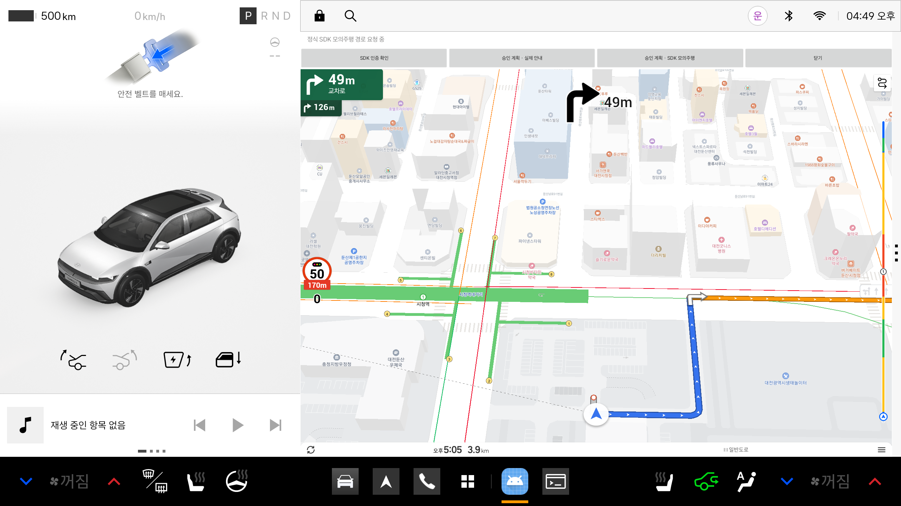
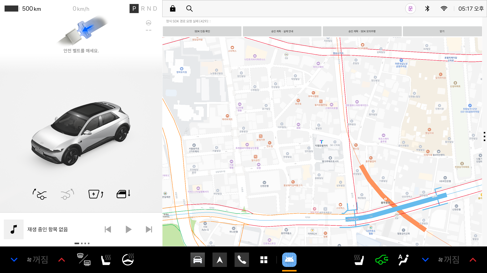

# 정식 TMAP 내비 SDK 연결 및 검증

> **2026-11-11 후속 구현:** [한 대 내비에 동행 차량 위치 표시](SINGLE_NAVIGATION_CONVOY.md). A의 공식 길안내 화면을 켜 둔 채 B의 GPS를 보라색 자동차 마커로 표시하고 이동·만료·복원을 검증했다. 아래는 최초 연결 당시 기록이다.

2026-11-10. 앱 안에 **공식 TMAP NavigationFragment**를 연결했다. ClientID는 발급받지 않은 상태지만 기존 AppKey로 두 Pleos 에뮬레이터의 SDK 초기화가 성공했다. 정식 길안내 화면까지 표시했으며, 이후 경로 요청은 **429**로 제한됐다. **SDK 내부 모의주행의 이동·경유·최종 도착은 아직 검증하지 못했다.**

## 확인한 결과

| 항목 | 결과 | 근거 |
| --- | --- | --- |
| 최종 debug 앱·테스트 APK 빌드 | 통과 | `assembleDebug`, `assembleDebugAndroidTest` |
| JVM 테스트 | 5개 통과, 실패 0 | `testDebugUnitTest` |
| 1번 에뮬레이터 SDK 초기화 | SDK_READY, ClientID 비어 있음 | [결과](test-results/2026-11-10-native-tmap-sdk/emulator-5554-initialization-result.json), [계측 테스트](test-results/2026-11-10-native-tmap-sdk/emulator-5554-initialization-instrumentation.txt) |
| 2번 에뮬레이터 SDK 초기화 | SDK_READY, ClientID 비어 있음 | [결과](test-results/2026-11-10-native-tmap-sdk/emulator-5556-initialization-result.json), [계측 테스트](test-results/2026-11-10-native-tmap-sdk/emulator-5556-initialization-instrumentation.txt) |
| 정식 내비 UI | 3D 건물, 회전 안내, 도로 경로, 제한속도 표시 확인 | 아래 첫 화면 |
| 후속 SDK 경로 요청 | 실패: 공급자 오류 코드 429 | [실제 응답 기록](test-results/2026-11-10-native-tmap-sdk/route-request-result.json) |
| SDK 내부 모의주행 | 미검증 | 경로 요청이 제한돼 이동·도착 확인 불가 |

두 에뮬레이터는 x86_64이며 내려받은 SDK의 내비 엔진·지도 네이티브 라이브러리에 해당 ABI가 포함돼 있다. 최종 APK를 양쪽에 설치하고 초기화만 다시 확인했으며 추가 길안내 요청은 하지 않았다.

### 실제 표시된 공식 길안내 화면

이 화면은 최초 구현 단계에서 표시된 **정지 GPS 상태의 실제 안내 화면**이다. 당시 상단 자체 상태 문구에는 모의주행 요청이라고 표시됐지만, SDK API의 Boolean 인자를 잘못 해석한 상태였다. 이 스크린샷을 모의주행 성공 근거로 사용하지 않는다. 현재 구현에서는 `requestRoute`의 `withoutPreview`와 `startDrivingForJava(..., simulation=true, ...)`를 구분했다.

### 후속 요청의 제한 화면

위 기록은 2번 에뮬레이터에서 SDK 초기화 후 대전 출발 좌표와 승인된 경유지 1개를 전달한 요청이다. 공급자 메시지는 비어 있고 오류 코드가 429였다. 최종 앱은 이 경우 내비게이션 사용량·한도 확인 안내를 표시한다. 자동 재시도는 추가하지 않았다.

[공식 요금표](https://openapi.sk.com/products/calc?svcSeq=4&menuSeq=5)와 [TMAP 약관](https://tmapapi.tmapmobility.com/terms.html)의 무료 제공표에서 **내비게이션은 일 1건**이다. REST 자동차 경로안내의 일 1,000건과 구분해야 한다. 이번 429는 해당 한도와 관련됐을 가능성이 있으나, 응답만으로 일일 한도 소진인지 요청 빈도 제한인지 확정할 수 없다. SK Open API 대시보드에서 해당 앱의 내비게이션 상품 사용량과 제한을 확인해야 한다. 반복 검증에 필요한 SDK 이용 조건은 공급자에게 문의한다. 유료 상품 신청이나 결제는 진행하지 않았다.

## 앱에서 사용하는 방법

1. 기존 모임에 참가하고 실제 위치 공유를 켠다. 모임의 목적지와 공동 경유지를 먼저 승인한다.
2. 메인 화면의 **정식 TMAP 내비 SDK** 버튼을 누른다. Android 위치 권한을 허용하고 초기화 성공을 확인한다.
3. **승인 계획 · 실제 안내** 또는 **승인 계획 · SDK 모의주행**을 누른다. 내비게이션 경로 요청이 발생하므로 공급자 한도가 사용된다.
4. 429가 발생하면 대시보드의 사용량·제한을 확인한 뒤 재시도한다. ClientID가 없다는 이유만으로 실패한 것으로 판단하지 않는다.

서버는 기존과 같이 `python server/convoy_server.py`로 실행한다. 각 에뮬레이터는 `http://10.0.2.2:8765`로 연결한다. 출발점은 최근 30초 이내 내 차량 GPS이며 목적지·경유지는 서버의 현재 승인 계획에서 읽는다. 운전자만 요청할 수 있다. 실제 주행 중 계획 변경을 자동으로 네이티브 SDK에 재적용하는 동작은 이번 연결 범위에 포함하지 않았고, 버튼으로 현재 계획을 요청한다.

지도 SDK의 위치 제공자는 공식 Android GPS 예제와 같은 기본 설정(`LocationInitParam=null`)을 사용한다. 경로 요청 출발점에는 Pleos FusedLocation으로 받은 내 차량 좌표를 명시한다. 주행 중 SDK의 위치 콜백으로 받은 좌표는 기존 모임 서버로 공유하도록 연결했으나, 이 콜백의 연속 이동과 실제 모의주행에서의 동기화는 아직 미검증이다. 기존 [시내 GPS 재생 테스트](CITY_DRIVING_DEMO.md)의 두 차량 도착 성공은 REST 기반 자체 주행 화면의 결과다.

## 구현과 설정

- 공식 샘플 패키지 1.78의 Maven 구성을 사용했다: UI SDK `1.0.0.0160`, Navigation SDK·EngineCommonData `11.0.0.1117`.
- [NativeTmapActivity.kt](../automotive/src/main/java/com/example/pleosprojectv01/NativeTmapActivity.kt)에 인증·경로 요청·SDK 모의주행 시작·상태 콜백을 연결했다. 초기화 성공과 경로 성공, 실제 안내와 SDK 모의주행 상태를 분리한다.
- 인증키는 Git에서 제외된 프로젝트 루트 `.env`의 `TMAP_APP_KEY`에서 빌드 시 읽는다. 향후 ClientID를 발급받으면 `TMAP_CLIENT_ID`에 넣고 다시 빌드한다. 이 조합의 초기화 성공이 모든 계정·상품에서 ClientID가 불필요하다는 뜻은 아니다.
- `.env`, APK, 내려받은 샘플과 로컬 모임 토큰은 Git에 포함하지 않는다. 앱의 진단 출력에는 키 값을 남기지 않는다.
- [공식 Android UI SDK 가이드](https://tmapapi.tmapmobility.com/main.html#androidUISDK/guide/androidGuide.sample1), [공식 SDK 다운로드](https://tmapapi.tmapmobility.com/main.html#androidUISDK/sample/androidSample.sdk_download)를 기준으로 연결했다.

## 에뮬레이터 GPU 확인

같은 작업 중 호스트에서 두 QEMU 프로세스가 NVIDIA OpenGL 드라이버(`nvoglv64.dll`)와 Vulkan 로더를 사용하고, 각각 Windows GPU 3D 엔진 사용률이 약 2%인 순간을 확인했다. GPU는 **NVIDIA GeForce RTX 5060**이다. `nvidia-smi`의 GPU 전체 사용률은 당시 16%, 메모리 약 5,735MiB였으며, 이 전체 수치는 다른 앱도 포함한다. 에뮬레이터별 VRAM 사용량이나 지속 부하 벤치마크로 해석하면 안 된다. GPU 설정을 변경하거나 에뮬레이터를 재시작하지 않았다.
