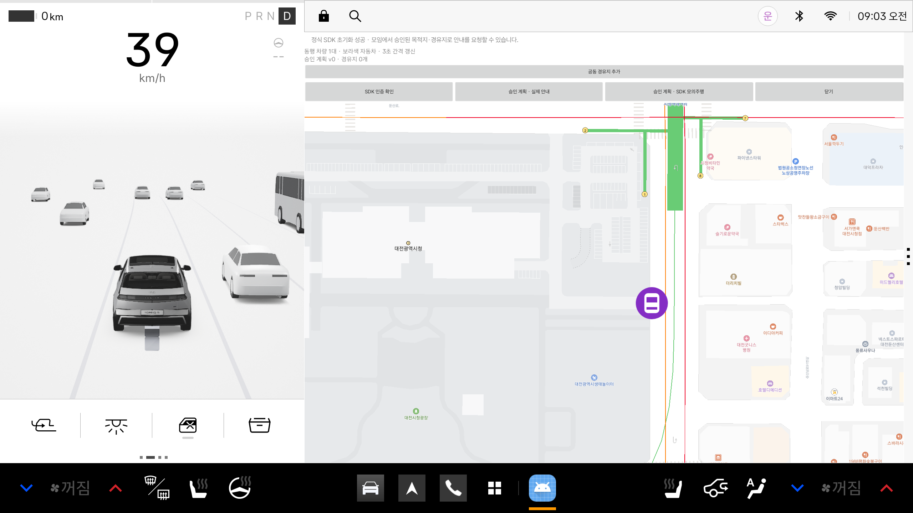

# 원격 업데이트 통합·동행 아이콘·가변 속도 녹화

> **최신 실제 길안내 주행 영상:** [ACTIVE_GUIDANCE_DRIVING.md](ACTIVE_GUIDANCE_DRIVING.md). 아래의 지도 미리보기·정지 상태 요청 검사 이후, GPS provider 갱신과 SDK 실제 경로 재생을 연결해 움직이는 내 차량·회전 안내·동행 아이콘을 같은 영상에서 최종 확인했다.

> **후속 실제 길안내 요청 성공:** 사용자의 명시적 요청으로 1번에서 실제 안내 버튼을 정확히 한 번 눌렀다. 이번 응답은 `NAVIGATION_RUNNING / error_code=0`, 경로 2,271m·494초였다. [성공 화면](test-results/2026-11-12-guidance-once/screen.png), [진단 결과](test-results/2026-11-12-guidance-once/result.json), [요청 장면 녹화](videos/2026-11-12/guidance-request/guidance-request.mp4). 2번에서는 내비 SDK를 실행하지 않았다. 아래의 429 기록은 앞선 시도의 결과이며 이번 성공과 구분한다. 길안내 시작 확인이며 전체 주행·도착 검증은 아니다.

2026-11-12. 다른 PC의 변경을 가져와 이 PC의 동행 마커와 합쳤다. **공식 TMAP 내비 SDK 지도 안에서 보라색 동행 차량 아이콘 표시와 이동을 확인했고, 차량별로 서로 다른 가변 속도를 GPS와 계기판에 반영해 두 화면을 MP4로 녹화했다.** 실제 길안내 경로 요청은 429로 거절됐다. 최종 아이콘 영상은 길안내를 재요청하지 않는 SDK 지도 미리보기다.

## 가져온 변경과 보존

- 저장소: `shpark5779/Pleos_Convoy`. 새 변경은 `main`이 아니라 `feature/convoy-gps-console-sync`에 있었다.
- 원격 커밋 `a10960f`의 GPS·Virtual Console 동기화, 지도 자동 갱신, 테스트·문서를 로컬에 병합했다. 병합 커밋은 `19b3f62`다.
- 이 PC의 기존 `f16c1e5`와 미커밋/스테이징 파일을 보존했다. 충돌난 NativeTmapActivity는 기존 마커와 새 외부 GPS 처리를 함께 유지하고, 계획/마커 조회를 하나의 주기로 합쳤다.
- `backup/pre-sync-20261112` 브랜치와 `pre-sync-20261112-local-staged` stash를 남겼고 보관했던 스테이징 파일을 복원했다. 기존 `.env`를 덮어쓰지 않았다. 이번 작업을 원격으로 푸시하지는 않았다.

## 실제 표시와 속도

| 항목 | 결과 |
| --- | --- |
| 1번 | 공식 TMAP NavigationFragment의 지도·동행 마커 |
| 2번 | TMAP REST 동행 지도, 정식 내비 SDK 초기화 없음 |
| 동행 아이콘 | 1번 지도에 보라색 자동차 1대 표시, 위치 갱신 확인 |
| 출발 | 대전시청 부근. 가시성 확인을 위해 2번을 같은 도로의 약 65m 앞에 배치 |
| 1번 속도 모델 | 주행 구간 약 23–41km/h, 출발 가속·감속·일시 정차 포함 |
| 2번 속도 모델 | 주행 구간 약 36–58km/h, 1번과 다른 주기와 정차 시점 |
| 최종 영상 표본의 최고 속도 | 1번 약 40.8km/h, 2번 약 50.1km/h |
| GPS·계기판 연결 | 같은 속도를 적분해 도로 경로를 따라 GPS를 이동하고 Virtual Console 차속도 동일 값으로 갱신 |
| 완료 상태 | 두 기기 P·0km/h 복귀를 읽어 확인 |

속도는 고정 72km/h가 아니다. 재현 가능한 부드러운 주기 함수와 정차 구간을 사용했으며 실제 교통·센서·랜덤 운전 모델은 아니다. 시작 가속·정차 중에는 위 주행 구간의 최저 속도보다 낮아지거나 0이 된다. GPS는 에뮬레이터 입력이며 실차 주행 기록이 아니다. 초기 약 82초 검사에서는 1번 약 641m, 2번 약 827m를 이동했다. 최종 약 60초 재녹화의 마지막 저장 표본은 각각 약 391m·532m였다.

SDK 길안내가 거절된 상태에서는 기본 지도 시점 때문에 등록된 마커가 화면 밖에 있었다. 외부 GPS debug 미리보기에서만 두 차량의 중간점을 중심으로 도로 축척을 맞추도록 수정했다. 정상 길안내의 카메라를 이 로직으로 덮어쓰지 않는다. 주행 중 테스트 화면을 확인할 수 있도록 NativeTmapActivity의 `distractionOptimized` 설정은 debug manifest에만 추가했다.



## 영상

두 기기의 원래 화면을 각각 1280×720, 소리 없는 MP4로 녹화했다. 최종 영상은 각각 약 72초다. 계기판과 앱 화면을 함께 볼 수 있다.

- [1번 · 공식 SDK 지도 + 동행 아이콘 + 가변 차속](videos/2026-11-12/native-overview/A-driving.mp4)
- [2번 · 동행 지도 + 다른 가변 차속](videos/2026-11-12/native-overview/B-driving.mp4)
- [초기 길안내 429 상태의 100초 녹화 · 1번](videos/2026-11-12/initial-route-failure/A-driving.mp4)
- [초기 100초 녹화 · 2번](videos/2026-11-12/initial-route-failure/B-driving.mp4)

최종 MP4 두 개에서 8초·24초·40초 프레임을 디코딩했다. 1번의 보라색 마커가 화면에 보이는 것을 시각적으로 확인했고 각 프레임의 보라색 아이콘 영역도 검사했다. 저장만 된 빈 파일로 판단한 것이 아니다. 영상은 약 15.7MB·16.8MB이며 저장소의 `docs/videos/2026-11-12/`에 Git LFS로 보관한다. 새 PC에서는 `git lfs pull`로 영상을 받는다.

## 길안내 요청 결과

이 작업의 최초 SDK 경로 요청은 `ROUTE_FAILED / 429`였다. 이후 아이콘 확인을 위해 SDK 지도만 여는 debug 실행 모드를 사용했고 추가 길안내 요청 없이 재녹화했다. **동행 아이콘 표시 성공을 실제 길안내·재탐색·도착 성공으로 해석하면 안 된다.** 초기 SDK 거절 자료와 최종 지도 미리보기 자료는 별도 폴더에 보존했다.

가변 속도·아이콘 검증에서는 경유지 변경을 일부러 수행하지 않았다. 이전의 제안·승인 검증은 [주행 중 경유지 승인 보고서](DRIVING_APPROVAL_DEMO.md)를 참고한다.

## 검증·실행

- 최종 debug APK 빌드 및 JVM 테스트 5개 통과.
- Python 서버·GPS·콘솔·가변 속도 테스트 **37개 통과**.
- `node server/test_driving.cjs`, `node server/test_mixed_map.cjs` 통과.
- [최초 주행 측정값·429 결과](test-results/2026-11-12-native-variable/result.json)
- [최종 SDK 지도·가변 속도 측정값](test-results/2026-11-12-native-variable/overview/result.json)
- [MP4 길이·프레임 디코딩·아이콘 검사](test-results/2026-11-12-native-variable/video-validation.json)

```powershell
# 내비 SDK 경로 요청을 1회 시도하고 두 화면 녹화
python server/demo_native_variable.py

# SDK 경로를 요청하지 않고 공식 SDK 지도에 동행 아이콘을 표시·녹화
python server/demo_native_variable.py --overview
```

두 기기의 기존 앱 화면과 모임 설정을 테스트 모임으로 교체한다. 별도 로컬 서버는 8768 포트를 사용하므로 동일 테스트 서버가 실행 중이면 먼저 종료해야 한다. 녹화 후 프로세스가 유지되어야 모임 서버가 계속 실행된다. 기록 경로의 파일은 재실행 시 새 결과로 바뀐다. 인증 토큰은 `build/native-variable-20261112/` 아래 비공개 세션 파일에만 저장한다.
