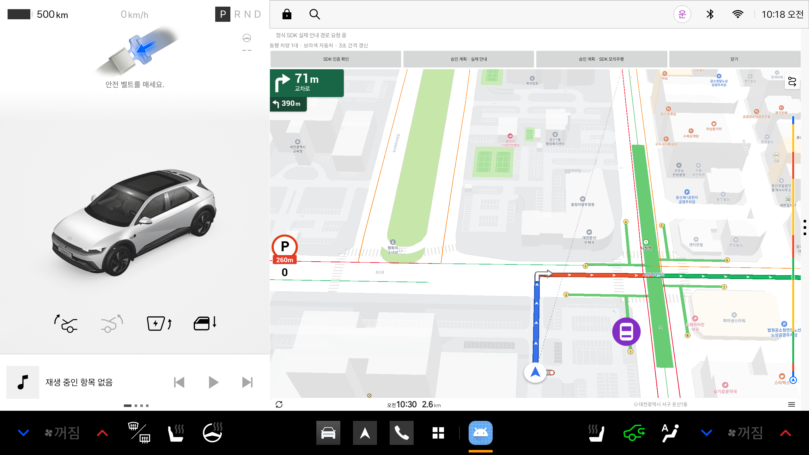
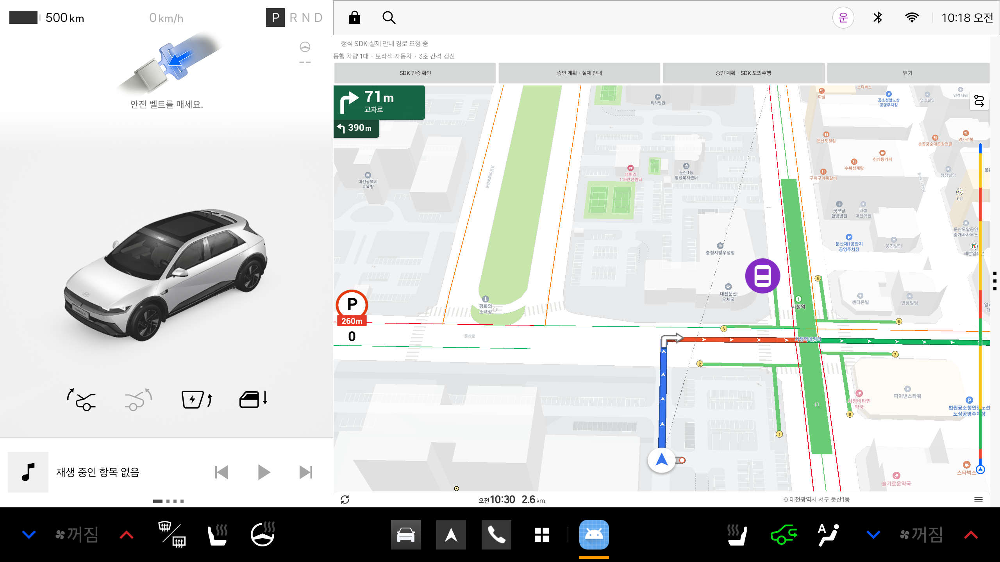
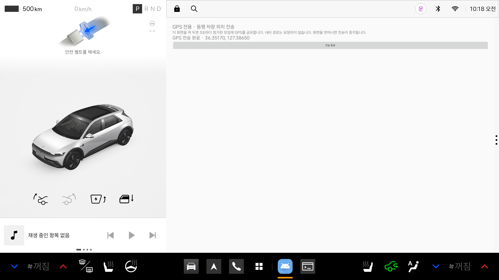
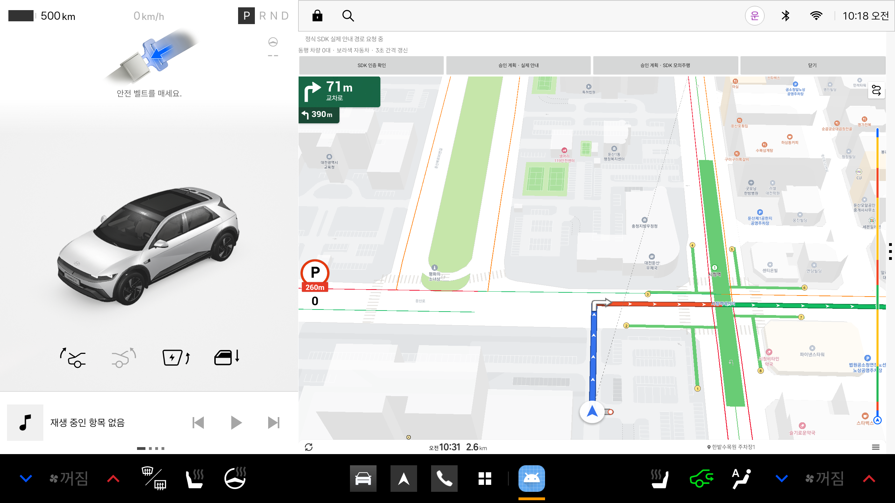

# 한 대의 정식 내비에 동행 차량 위치 표시

> 후속 검증: [두 차량 주행 중 경유지 제안·승인](DRIVING_APPROVAL_DEMO.md). 약 4.8km 떨어진 출발지에서 각자 도로 경로를 따라 이동하고, 실제 화면의 제안·승인 후 두 REST 경로 변경을 확인했다. SDK 반영 요청은 429로 거절됐다.

2026-11-11. **A만 TMAP 내비 SDK를 열고 B는 GPS 전용 화면에서 좌표만 전송**하도록 구현했다. 같은 모임 서버를 통해 B의 위치를 A의 공식 내비 지도 위 보라색 자동차 마커로 표시한다. 별도의 지도 화면을 덧씌운 방식이 아니라 공식 VSM 지도 마커 API를 사용한다.

## 구현

- A: 메인의 **정식 TMAP 내비 SDK** → **승인 계획 · 실제 안내**. 내 차량은 SDK의 파란 화살표, 동행 차량은 보라색 자동차로 구분한다.
- B: 같은 모임에 참가한 뒤 **GPS만 공유 · 내비 미사용**. Pleos FusedLocation의 좌표를 약 3초 간격으로 모임 서버에 전송한다. 이 화면에서는 TMAP SDK 초기화와 내비 경로 요청을 하지 않는다.
- A도 약 3초 간격으로 인증된 모임 정보를 조회해 동행 마커를 갱신한다. 화면에는 표시 중인 동행 차량 수를 보여 준다.
- 자기 자신과 동승자는 마커에서 제외한다. 좌표 범위·측정 시간을 검사하고 30초 초과, 미래 5초 초과, 위치 없는 차량은 숨긴다. 통신 실패 시 마커를 제거하고 수신 실패를 표시한다. 다시 신선한 좌표를 받으면 복원한다.
- 좌표 공유는 같은 모임의 참가 토큰으로 보호된 기존 API를 재사용한다. B는 TMAP 서버에 좌표를 직접 보내지 않는다.

GPS 전용 화면은 **켜 둔 동안 전송하는 방식**이며 화면 자동 꺼짐을 방지한다. 뒤로 가기·전송 종료·다른 앱으로 이동하면 전송이 중지된다. 화면을 꺼도 동작하는 백그라운드 서비스는 이번 범위에 포함하지 않았다. 실제 차량 이동과 앱이 종료된 뒤의 추적을 검증한 결과도 아니다.

## 두 에뮬레이터 검증

두 기기에 변경한 debug APK를 설치했다. A(`emulator-5554`)는 대전시청 부근에서 한밭수목원 주차장1까지 정식 길안내를 **명시적으로 한 번만** 요청했다. 공식 내비의 회전 안내와 약 2.6km 경로가 표시됐고 SDK가 제공한 총 거리는 2,589m였다. B(`emulator-5556`)에서는 GPS 전용 화면을 사용했다.

| 확인 항목 | 결과 |
| --- | --- |
| debug 앱·계측 테스트 APK 빌드 | 통과 |
| 기존 JVM 테스트 | 5개 통과 |
| 마커 대상 필터·이동·만료 계측 테스트 | 3개 통과 |
| B의 GPS → 서버 → A 지도 마커 | 세 좌표 모두 반영 |
| B가 내비 SDK를 초기화하지 않는지 | 새 실행 로그에서 SDK 초기화·경로 요청 없음 |
| B 전송 종료 후 30초 경과 | A 마커 제거 확인 |
| B GPS 공유 재시작 | A 마커 복원 확인 |
| 서버 연결 중단 | 수신 실패 표시와 마커 제거 화면 확인 |

B의 위도를 `36.3509 → 36.3513 → 36.3517`로 바꾸었다. 좌표는 `adb emu geo fix`를 통해 에뮬레이터 GPS에 주입했고, 앱의 실제 Pleos SDK 수신과 서버 전송을 거쳤다. 지도에 임의 마커만 움직여서 만든 결과가 아니다. 이동 중 A의 길안내 화면을 유지했다. A 자체는 정지 GPS 상태였으며 전체 경로 주행·최종 도착은 테스트하지 않았다.









[자동 검증 결과](test-results/2026-11-11-single-navigation/result.json), [마커 계측 테스트](test-results/2026-11-11-single-navigation/marker-filter-tests.txt).

SDK가 길안내 화면과 거리 정보를 제공했지만 기존 앱 상단의 자체 상태 문구가 `경로 요청 중`에 머무르는 콜백 상태 문제가 관찰됐다. 따라서 진단 JSON의 `ROUTE_REQUESTED`만으로 안내 실패라고 판단하면 안 된다. 실제 공식 안내 화면을 별도로 확인했다. 이 상태 문구 문제와 SDK 내부 모의주행·도착 검증은 남아 있다.

최초 자동 검사는 ADB 응답 지연으로 중단됐다. 기존 로컬 모임을 복원한 뒤 **추가 내비 경로 요청 없이** 이동·만료·복원 검사를 완료했다. 최종 확인에서는 동행 마커 수가 1이고 좌표가 새 값과 일치하는지를 함께 검사했다. 명시적 길안내 호출을 A에 한 번만 보냈다는 의미이며, SDK 내부 재탐색·교통 요청까지 공급자의 일일 사용량이 정확히 한 건이라고 보장하는 것은 아니다.

## 재실행

기존 테스트처럼 두 에뮬레이터와 빌드된 앱·테스트 APK가 필요하다. 다음 명령은 8766 포트에 별도 로컬 서버와 새 모임을 만들고 두 앱을 설정한다. 기존 8765 서버의 모임은 변경하지 않는다.

```powershell
# SDK 길안내 요청 없이 GPS/마커 전달 검사
python server/demo_single_navigation.py

# A에서만 정식 길안내 요청 1회 추가 (SDK 이용 한도 사용)
python server/demo_single_navigation.py --navigate
```

새 실행은 두 앱을 다시 열므로 기존 길안내 화면은 종료된다. 검사 후 명령을 계속 실행해 두어야 시연 서버가 유지된다. 길안내 없이 지도만 연 경우 기본 지도 시점이 동행 좌표와 다를 수 있다.

ADB 지연 등으로 검사가 중단됐지만 기존 앱 화면이 남아 있으면 `--resume`으로 로컬 모임을 복원하고 기존 화면을 검사할 수 있다. 이 옵션은 새 SDK 경로를 요청하지 않는다. 동시 실행하면 8766 포트가 충돌하므로 기존 서버가 종료된 경우에 사용한다.

토큰과 모임 복원 데이터는 Git 제외 경로 `build/single-navigation-session.json`에만 저장한다. 현재 시연은 A 길안내 + B GPS 공유를 켜 둔 상태다.
