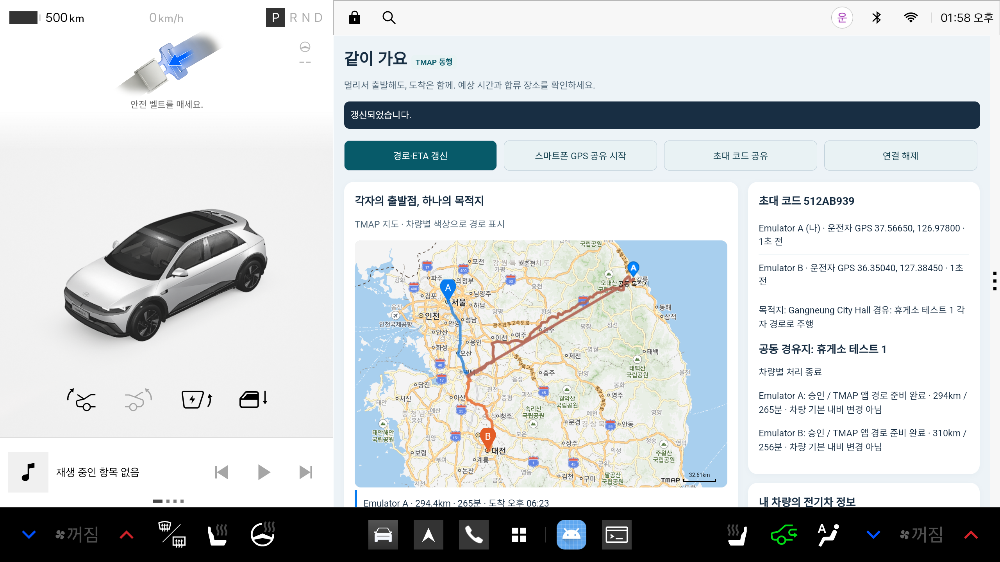
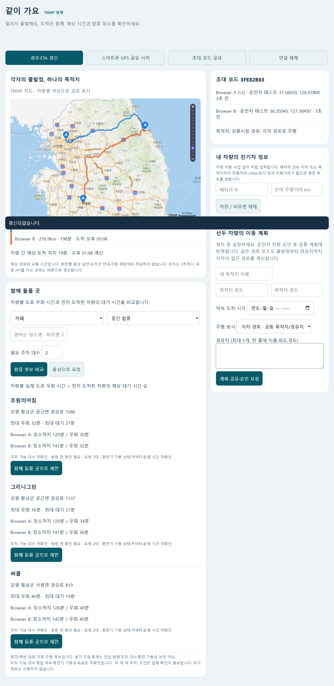

# TMAP 동행 기능 구현 및 검증

> **정식 내비 SDK 추가:** [Native SDK 연결과 실제 검증 범위](NATIVE_TMAP_SDK.md). 기존 REST 지도와 별도로 공식 길안내 화면을 연결했다. 두 기기 초기화 성공, 후속 경로 요청 429, SDK 내부 모의주행 미검증을 구분해 기록했다.

2026-11-10. 유가 정보는 요청에 따라 제외했다. 기본 Navigation의 현위치 고정 문제는 그대로이며, 동행 앱 안에서 TMAP 도로 경로와 교통 ETA를 계산하는 방식을 추가했다.

## 시내 테스트 주행 화면 추가

**경로·ETA 갱신 → 테스트 주행 화면**으로 현재 위치 추적, 다음 회전 거리·문구, 남은 거리·시간 추정, GPS 속도와 일행 거리를 표시한다. 두 에뮬레이터의 GPS를 실제 TMAP 도로 좌표로 재생하는 시내 시나리오를 추가했다. 정식 내비 SDK·기본 내비 주행, 음성·차선 안내·자동 재탐색은 아니다. [시내 주행 실행 방법과 검증](CITY_DRIVING_DEMO.md).

## 경유지 이후 직선 표시 오류 수정

TMAP 경유지 응답의 마지막에는 `경유지와 연결된 가상의 라인입니다`라는 보조 LineString이 붙는다. 이전 코드는 모든 LineString을 하나의 좌표 배열에 합쳤기 때문에 도착 좌표 뒤에 경유지 좌표가 이어져 가짜 직선이 그려졌다. 울산 시연의 원본 응답에서 이 점프는 약 **37.255km**였다. 최초 서울·대전 시연에서도 같은 표시 오류가 있었다.

`lineIndex`가 있는 실제 도로 링크만 경로에 포함하도록 수정했다. 지도는 각 도로 구간을 별도 Polyline으로 그려 구간 사이를 임의로 잇지 않는다. 합류 위치 계산도 구간 내부 길이만 사용한다. ETA와 거리는 계속 TMAP이 계산한 총계를 사용한다.

회귀 테스트를 포함한 서버 테스트 **30개 통과**. 현재 울산 모임을 복원해 두 차량을 다시 계산한 결과 도로 구간 사이 점프는 모두 0m, 마지막 점과 목적지의 차이는 약 2.77m였다. 두 에뮬레이터 화면에서 직선이 사라진 것을 확인했다. [실API 수치](test-results/2026-11-10-route-geometry-fix/live-geometry-check.json), [1번 수정 화면](test-results/2026-11-10-route-geometry-fix/emulator-5554.png), [2번 수정 화면](test-results/2026-11-10-route-geometry-fix/emulator-5556.png).

아래 최초 시연 기록과 과거 스크린샷은 수정 전 결과를 포함한다. 최신 지도 표시는 위 수정 화면을 기준으로 한다.

## 사용하는 방법

1. 로컬 `.env`에 `TMAP_APP_KEY`를 설정한다. 전달받은 키로 설정해 두었으며 Git에서 제외된다. 설정 항목은 루트 `.env.example`에 있다.
2. `python server/convoy_server.py`로 서버를 시작한다. 기본 주소는 `127.0.0.1:8765`, 에뮬레이터에서는 `http://10.0.2.2:8765`다.
3. 차량 A가 모임을 만들고 B가 초대 코드로 참가한다. 두 화면에서 **실제 차량 위치 공유**를 켠다.
4. **TMAP 동행 지도 · ETA · 합류 후보**를 누르고 **경로·ETA 갱신**을 누른다. 지도 화면에서도 Pleos SDK 위치 공유가 이어진다.
5. 장소 종류와 중간/후반 만남을 선택하고 **합류 후보 비교**를 누른다. 후보를 제안하고 운전자들이 승인하면, 각자 **내 앱 경로에 반영**한다.
6. 선두 차량은 새 목적지·경유지·약속 시각을 계획으로 제안할 수 있다. 배터리와 잔여 주행거리는 직접 입력한다.

컴퓨터 브라우저에서는 `http://127.0.0.1:8765/journey`로 같은 화면을 확인할 수 있다. 스마트폰은 접근 가능한 HTTPS 서버의 `/journey`에서 운전자 또는 동승자로 참가한다. **동승자는 후보를 제안할 수 있지만 운전자 대신 승인하거나 경로를 반영할 수 없다.** 초대 공유에는 서버 주소와 초대 코드만 포함하며 참가 토큰은 포함하지 않는다.

서버 기본 바인딩은 루프백이다. LAN 개발 접속이 필요하면 `python server/convoy_server.py --host 0.0.0.0`로 명시적으로 연다. 스마트폰 GPS는 HTTPS 또는 localhost 보안 컨텍스트가 필요하다. TLS 배포·공개 서비스 운영 설정은 이번 작업에 포함하지 않았다. 에뮬레이터 주소 `10.0.2.2`는 실제 스마트폰에서 사용할 수 없다.

## 요청한 주요 기능의 현재 범위

| 요구 기능 | 구현 | 검증/제한 |
|---|---|---|
| Gleo 동행 현황 | `SHOW_CONVOY_STATUS`에서 도로 ETA 차이를 반환. 화면에서 차량별 ETA·약속 시각 기준 출발 권장 시각 표시 | 실제 TMAP 계산 검증. Gleo 서버의 자연어 인식부터 음성 응답까지 실기 연결 검증은 남음 |
| 중간·마지막 만남 | 각 차량 도로 경로의 50% 또는 85% 지점 주변에서 장소를 찾고, 도로 우회 시간+대기 시간으로 정렬 | 실제 후보 검증. 마지막 만남은 목적지 전 후반 후보이며 도로 분기점을 추출하는 기능은 아님 |
| 대화형 공동 경유지 | Gleo에 카페·식당·휴게소·충전소·주차장, 검색어, 합류 방식, 요청 주차 대수 파라미터 추가. 웹에 음성 인식 지원 브라우저용 요청·승인·거절·보류 처리 | 실제 장소·우회 시간 검증. 주차 대수·영업·충전기 실시간 상태·요금은 미확인 표시. 유가 제외 |
| 운전자 확인 / 동승자 조작 | 큰 승인·거절·보류 버튼, 동승자 별도 역할과 제안 권한. 서버에서도 운전자 승인 권한 강제 | 권한·승인 테스트 통과. 차량 Gleo 음성만으로 승인 확정은 미구현. 상세 입력은 정차 중 사용 안내이며 차량 P단 자동 잠금은 미구현 |
| 선두 차량 계획 공유 | 목적지·최대 5개 경유지·약속 시각·주행 모드를 운전자 전원 승인 후 원자적으로 반영. 기존 경유지 유지 | 역할·계획 변경 경쟁 조건 테스트 통과. 같은 경로 모드는 공동 경유지 순서 공유이며 동일 도로 강제 추종은 아님 |
| EV 충전 | 수동 SOC 20% 이하 또는 잔여 주행거리 부족 시 충전 추천. 충전소 후보의 도로 우회·대기 시간 비교 후 일반 승인 흐름 사용 | 실제 충전 POI 검색 검증. SOC 자동 수집, 커넥터 적합성·잔여 충전기·충전 요금은 미연동 |
| 차종 간 참여 | 같은 웹 화면의 초대 코드 참가·휴대폰 GPS 전송·동승자 제안 | 휴대폰 폭 렌더링과 서버 역할 검증. 실제 휴대폰 GPS 및 각 제조사 기본 내비 전송 어댑터는 미검증/미구현 |

**TMAP REST 경로 계산·지도 표시는 회전별 음성 길안내 SDK와 다르다.** 자동 재탐색, 차선 안내, 백그라운드 위치, 차량 기본 내비 갱신은 제공하지 않는다. 경로 반영 성공은 `TMAP 앱 경로 준비 완료`로 표시하며 NaviHelper 성공으로 기록하지 않는다. 기본 내비 관련 기존 조사는 [NAVIGATION_GPS_FIX.md](NAVIGATION_GPS_FIX.md)를 참고한다.

## 검증 결과

- Python 서버 테스트 30개 통과. 인증, 동승자 권한, 선두 계획 승인, 오래된 위치 거부, 계산 도중 계획 변경 거부, 도로 우회·대기 정렬, 검색 반경, 요청 예산, 경유지 보조 선 제외와 구간 간 연결 방지 검증 포함.
- Android debug / androidTest 빌드와 기존 JVM 테스트 5개 통과.
- 두 Pleos 에뮬레이터에서 `TwoEmulatorFlowTest` 각각 통과: A 서울 `(37.5665, 126.9780)`, B 대전 `(36.3504, 127.3845)`, 목적지 강릉. 실제 FusedLocation SDK 위치가 서로 다르게 공유되고 승인·각자 TMAP 경로 계산 성공을 확인했다. 이 흐름의 경유지는 UI 검증용 테스트 좌표다.
- `JourneyMapTest` 각각 통과: 실제 차량 WebView에서 TMAP JS 지도, 서울·대전 좌표, 두 차량 ETA를 확인했다. 테스트 안에서 화면을 캡처한다.
- Playwright 실제 브라우저: TMAP 배경 지도에 두 색상의 다른 경로 표시. 초기 직행 예시 A 226.4km/179분, B 276.9km/198분, 도착 차이 19분. 이는 해당 시점의 교통 예상치다.
- 실제 카페 세 곳 검색 및 도로 비교 확인. 첫 후보 `초원의아침`의 최대 우회 약 32분·예상 대기 21분. 주차 가능 대수는 미확인으로 표시했다.
- 390px 폭 스마트폰 레이아웃에서 가로 넘침 없음.
- `python server/smoke_tmap.py` 실API 검사 통과: 약속 기준 출발 시각, EV 경고, 후반 카페 및 중간 충전소 후보를 실제 TMAP 응답으로 확인. 이 검사의 위치는 명시적인 시뮬레이션이며 API 요청 28회 사용.
- 기존 실패하던 지연 GPS 패킷 덮어쓰기 문제 수정: 더 오래된 측정 시각의 패킷은 최신 위치를 교체하지 않는다.

원본 결과와 화면: [test-results/2026-11-10-tmap-two-emulators](test-results/2026-11-10-tmap-two-emulators/).

## API 및 운영 처리

자동차 경로 `POST /tmap/routes?version=1`, 장소 검색 `GET /tmap/pois`를 사용한다. 거리순 POI 검색에는 중심 좌표 외에 필수 `radius`가 필요해 30km를 지정했다. 경유지는 `passList`로 전달한다. TMAP POI ID를 Pleos ID로 가장하지 않는다.

외부 요청 중에는 모임 잠금을 잡지 않는다. 계산 후 계획 버전을 재검증하며 승인 전·다른 시도의 경로 반영을 거부한다. API 오류는 키나 요청 URL을 포함하지 않는 오류로 변환한다. 도로 계산에 실패한 후보를 우회 0분 후보로 처리하지 않는다.

경로는 30초, POI는 5분 캐시한다. 위치 공유/모임 조회는 3초 간격이며, 경로·후보는 명시적인 요청에만 계산해 반복 폴링으로 외부 API를 호출하지 않는다. `TMAP_DAILY_BUDGET=600`은 **프로세스 단위** 일일 요청 제한이며 재시작하면 초기화된다. 공급자 계정의 청구 상한이나 다중 프로세스 공유 한도는 아니다.

REST 키는 서버 `.env`에서 읽는다. JS 지도에는 클라이언트용 키가 필요하므로 인증된 모임 참가자에게 지도 키를 전달한다. `TMAP_MAP_KEY`를 별도로 설정할 수 있고, 없으면 현재 AppKey를 사용한다. 키가 포함될 수 있는 브라우저 로컬 진단 로그 `.playwright-cli/`도 Git에서 제외했다. 저장소의 문서·테스트 결과에는 키와 참가 인증 토큰을 기록하지 않는다.

이 서버는 기존과 같이 메모리 기반 시제품이다. 서버 재시작 시 모임이 사라지며, 공개 운영용 영속 저장·TLS·계정 인증·지속 쿼터는 별도 작업이다.

공식 참고: [TMAP 상품](https://openapi.sk.com/products/detail?svcSeq=4&menuSeq=3), [자동차 경로](https://tmap-skopenapi.readme.io/reference/자동차-경로안내), [장소 통합 검색](https://tmap-skopenapi.readme.io/reference/장소통합검색).
