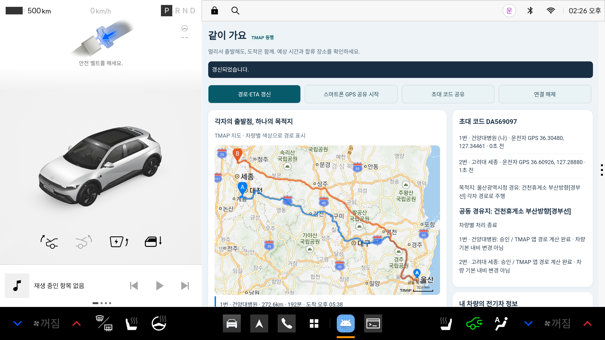
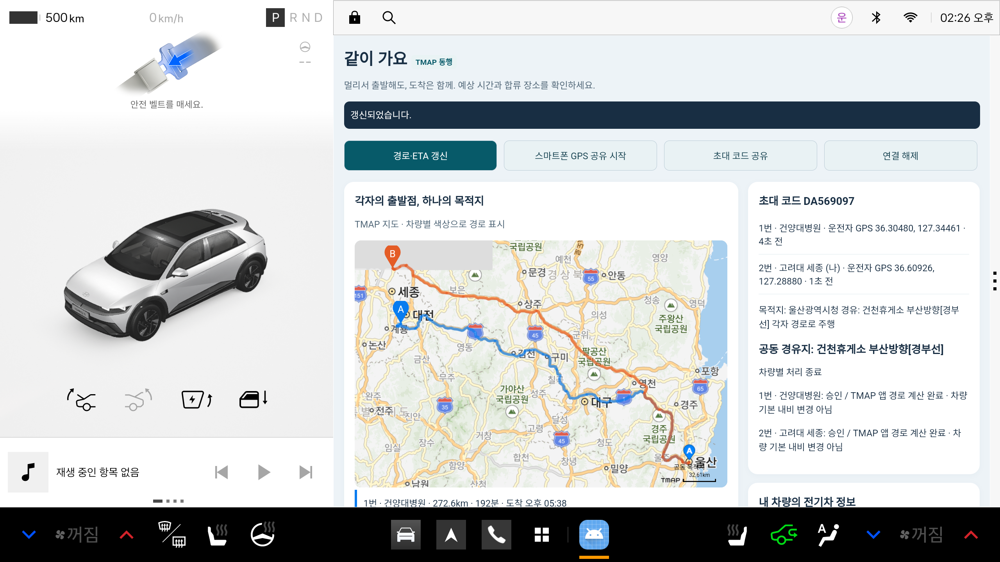

# 건양대병원·고려대 세종 → 울산 동행 시연

2026-11-10. 두 Pleos 에뮬레이터에서 실제 앱 화면으로 제안·승인·경로 반영을 실행했다. 종료 후 두 화면은 TMAP 지도 상태로 남겨 두었다. 모임 코드는 `DA569097`이며 서버 재시작 시 사라진다.

| 차량 | 출발지 | 에뮬레이터 GPS 좌표 |
|---|---|---|
| 1번 | 대전 건양대학교병원 | 36.30480063, 127.34460621 |
| 2번 | 고려대학교 세종캠퍼스 | 36.60926476, 127.28879738 |

사용자가 울산 내 세부 지점을 지정하지 않아 목적지는 **울산광역시청** `(35.53870119, 129.31098144)`으로 정했다. 출발지와 목적지 좌표는 TMAP 정확도순 POI 검색으로 확인했다. 에뮬레이터 GPS에 지정한 좌표를 주입하고, 앱의 FusedLocation SDK에서 `source=sdk`로 수신·공유되는 것을 확인했다. 실제 도로 주행 기록은 아니다.

## 함께 들를 장소

**건천휴게소 부산방향[경부선]** `(35.83066449, 129.10860201)`을 공동 경유지로 반영했다. 단순 지리적 중간보다 같은 방향으로 진입할 때의 우회·대기 시간을 우선했다. 아래 값은 비교 시점의 TMAP 교통 예상이며 휴식 시간은 포함하지 않는다.

| 휴게소 | 1번 우회 | 2번 우회 | 먼저 도착한 차량의 예상 대기 |
|---|---:|---:|---:|
| 추풍령 부산방향 | 1.9분 | 25.7분 | 24.1분 |
| 김천 부산방향 | 3.3분 | 27.6분 | 24.1분 |
| 군위영천 영천방향 | 14.2분 | 4.3분 | 7.9분 |
| **건천 부산방향** | **1.5분** | **1.5분** | **1.7분** |

건천휴게소까지는 1번 약 141분, 2번 약 143분이다. 두 차량은 초반에 다른 고속도로 경로를 사용하다 목적지 전 공통 구간에서 만난다. 전체 이동의 정확한 절반 지점은 아니다. 휴게소 방문 후 울산시청까지는 비교 당시 약 51분이었다.

기존 자동 중간 검색의 첫 후보는 칠곡의 일반도로 휴게소들이었고 최대 우회가 약 26~34분이었다. 그래서 고속도로 휴게소 네 곳을 별도 검색·계산하여 건천을 선택했다. **이번 최종 선택이 앱의 자동 검색 첫 결과였던 것으로 해석하면 안 된다.** 자동 후보 생성 범위와 고속도로 방향 구분은 개선 여지가 있다.

## 화면에서 실행한 순서와 결과

1. 두 기기에 서로 다른 출발 GPS를 설정하고 실제 차량 위치 공유를 켰다.
2. 같은 모임에 참가한 상태로 TMAP 지도에서 울산행 경로·ETA를 조회했다.
3. 1번이 건천휴게소를 제안하고, 2번 화면의 **승인** 버튼을 눌렀다.
4. 양쪽 화면의 **내 앱 경로에 반영**과 확인 대화상자의 **확인**을 눌렀다.
5. 두 차량 모두 `succeeded`, 제안은 `completed`로 종료했다. 최종 스냅샷에서 두 기기의 최근 SDK GPS가 출발 좌표와 일치하는 것도 확인했다.

시연 중 WebView에서 JavaScript `confirm()`이 표시되지 않는 실제 결함을 발견했다. `JourneyActivity`에 `WebChromeClient.onJsConfirm`과 네이티브 확인 대화상자를 연결했다. 수정 APK를 양쪽에 설치한 뒤 위 반영 흐름을 재실행했다. 실제 터치로 취소하면 `false`, 확인하면 `true`가 반환되는 `JourneyConfirmationTest`도 통과했다. [Android 공식 문서](https://developer.android.com/reference/android/webkit/WebChromeClient)에 따르면 WebChromeClient가 없으면 기본 확인 대화상자가 억제되고 `false`가 반환된다.

차량 기본 내비는 변경하지 않는다. 이번 성공은 동행 앱 안의 TMAP 경로 계산·표시 성공이다. 휴게소 영업·주차 여유 대수는 확인하지 않았다. 경로 이동 재생은 시작하지 않았으며 두 기기는 지정한 출발 위치에서 대기한다.

경유지 이후 직선이 표시되던 오류는 후속 검증에서 수정했다. [원인과 검증](TMAP_IMPLEMENTATION.md#경유지-이후-직선-표시-오류-수정). 아래는 수정 후 같은 모임의 화면이다.

원본: [시나리오](test-results/2026-11-10-konyang-sejong-ulsan/scenario.json), [휴게소 도로 비교](test-results/2026-11-10-konyang-sejong-ulsan/highway-comparison.json), [최종 모임 상태](test-results/2026-11-10-konyang-sejong-ulsan/room-result.json), [확인창 회귀 테스트](test-results/2026-11-10-konyang-sejong-ulsan/confirmation-test.txt).

장소 확인 참고: [건양대학교병원](https://www.kyuh.ac.kr/), [고려대학교 세종캠퍼스](https://software.korea.ac.kr/sites/koreaSejong/index.do). 세부 좌표·차량별 경로·시간은 TMAP 실API 응답을 사용했다.
